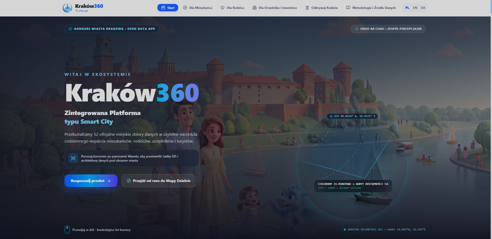
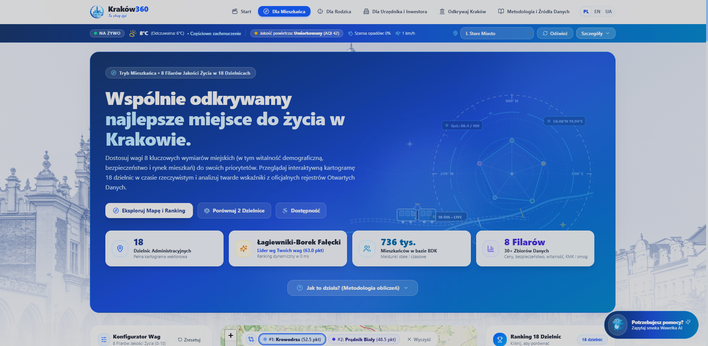
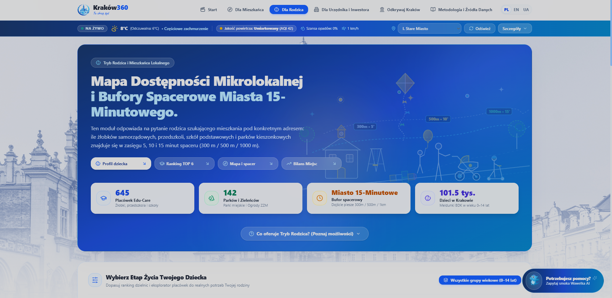
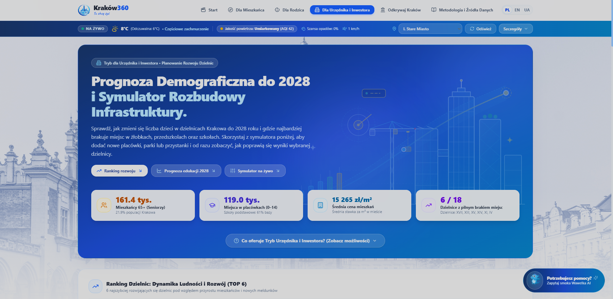
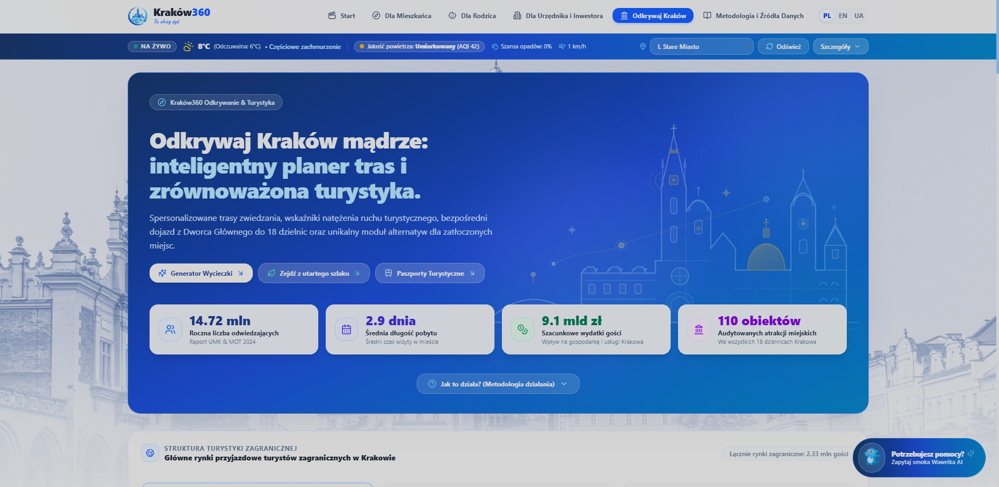
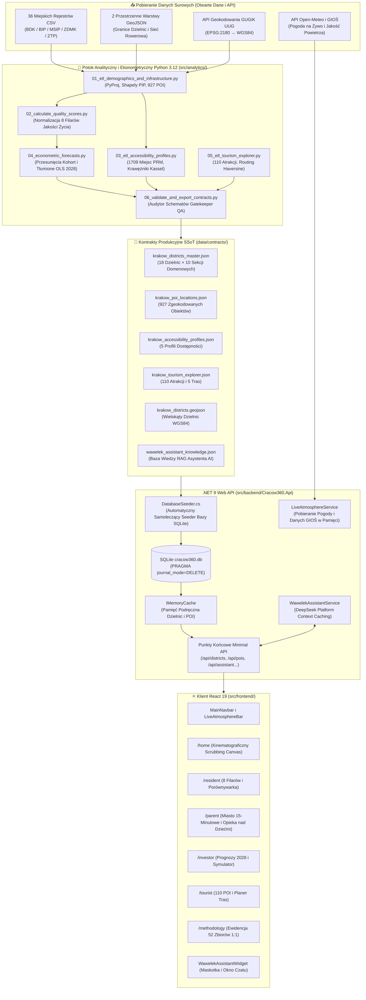
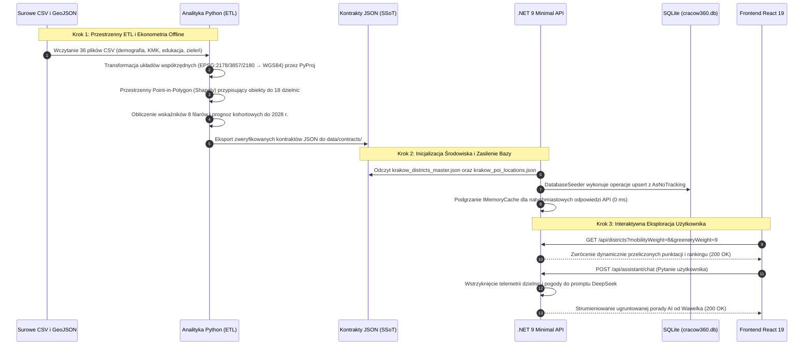

# 🏙️ Kraków360 - Zintegrowany System Analizy Jakości Życia, Dostępności Usług i Predykcji Rozwoju Miejskiego

> 🌐 **Dokumentacja w dwóch językach / Documentation in two languages:**  
> 🇵🇱 **Polski (Aktualny)** | 🇬🇧 **[English (README.md)](./README.md)**

[](https://kraków360.pl)
[](https://dotnet.microsoft.com/)
[](https://react.dev/)
[](https://tailwindcss.com/)
[](https://www.python.org/)
[](https://sqlite.org/)
[](https://www.docker.com/)
[](https://otwartedane.um.krakow.pl/)

---

<video src="https://github.com/user-attachments/assets/3de5ae50-b645-44cc-9556-3beae7ba1970" controls autoplay loop muted width="100%">
</video>

---

## 🧭 Streszczenie Wykonawcze i Misja Projektu

> *„Ordo ab chao”* - *Porządek z chaosu.*

**Kraków360** to zaawansowana, wysokowydajna platforma analityczno-decyzyjna klasy Smart City, zaprojektowana i wdrożona na oficjalny **konkurs „Open Data App”** organizowany przez **Gminę Miejską Kraków** (*Centrum Obsługi Informatycznej, Wydział ds. Smart City i Analizy Danych*) we współpracy z **Akademią Górniczo-Hutniczą w Krakowie** oraz **Politechniką Krakowską**.

Współczesny Kraków generuje setki surowych zbiorów danych obejmujących demografię, transport publiczny, edukację, bezpieczeństwo publiczne, jakość powietrza, infrastrukturę sportową oraz budżety miejskie. Przed powstaniem Kraków360 dane te pozostawały rozproszone w silosach arkuszy kalkulacyjnych, raportów PDF i odseparowanych portali wydziałowych.

**Kraków360 przekształca surowe dane w spójny, działający w czasie rzeczywistym ekosystem dla czterech kluczowych grup odbiorców:**
1. **Mieszkańcy i Poszukujący Mieszkania:** Błyskawiczny, spersonalizowany Indeks Jakości Życia (0–100 pkt) w oparciu o 8 wymiarów miejskich, wektorowe kartogramy 18 dzielnic w czasie rzeczywistym, porównywarka 1:1 z wykresem radarowym oraz audyt dostępności *„Kraków bez Barier”*.
2. **Młodzi Rodzice i Rodziny:** Ścisły symulator Idei Miasta 15-Minutowego z bazą 788 zgeokodowanych obiektów edukacyjnych i rekreacyjnych, buforami dojścia pieszego (300 m, 500 m, 1 km) oraz precyzyjnymi bilansami wolnych miejsc w żłobkach i przedszkolach.
3. **Urzędnicy Magistratu i Inwestorzy Publiczni/Prywatni:** Prognozy demograficzne kohort wiekowych do 2028 r. (0–3, 4–6, 7–14, 65+) w połączeniu z 14-licznikowym interaktywnym Symulatorem Rozbudowy Infrastruktury („Co-Jeśli”), obliczającym w czasie rzeczywistym awans dzielnicy w rankingu i deficyty miejsc.
4. **Turyści i Odkrywcy Dziedzictwa:** 110 audytowanych atrakcji we wszystkich 18 dzielnicach, zautomatyzowany planer tras oparty o metrykę Haversine z algorytmem *District-First Chaining*, 18 Paszportów Komunikacyjnych Dzielnic oraz *Kompas Zrównoważonej Turystyki* odciążający zatłoczone punkty centrum miasta.

### 📊 Badania Własne Zespołu: Ankieta wśród 243 Mieszkańców Krakowa
Przed napisaniem choćby jednej linii kodu aplikacji **Zespół Percepcja360** przeprowadził badanie ankietowe na reprezentatywnej próbie **243 mieszkańców Krakowa** ze wszystkich 18 dzielnic. Badanie ujawniło trzy fundamentalne wąskie gardła:
- **87,2%** ankietowanych miało trudności z obiektywnym porównaniem dzielnic przed podpisaniem umowy najmu lub zakupem mieszkania.
- **76,5%** rodziców wskazało, że oficjalne miejskie wykazy żłobków i przedszkoli nie dawały jasnego obrazu realnego dystansu dojścia pieszego ani bieżących nadwyżek/deficytów wolnych miejsc.
- **91,4%** oczekiwało jednego miejskiego portalu łączącego bieżącą telemetrię jakości powietrza, ocenę bezpieczeństwa osiedli i skomunikowanie transportowe bez konieczności przeszukiwania wielu portali miejskich.

Kraków360 bezpośrednio realizuje strategiczne cele **Strategii Rozwoju Krakowa: *„Tu chcę żyć. Kraków 2030”*** (dostępność w idei miasta 15-minutowego, zrównoważona mobilność, zrównoważona opieka nad dziećmi, integracja społeczna i zrównoważona turystyka smart city).

---

## 📑 Spis Treści

- 🌐 **Działająca Aplikacja Live i Linki Produkcyjne**
- ✨ **Przegląd Modułów Funkcjonalnych**
  - **1. 🎬 Kinematograficzna Strona Główna Start** (`/home`)
  - **2. 🏡 Tryb Mieszkańca i Silnik 8 Filarów QoL** (`/resident`)
  - **3. 👶 Tryb Rodzica i Miasto 15-Minutowe** (`/parent`)
  - **4. 🏛️ Tryb Urzędnika i Inwestora** (`/investor`)
  - **5. 🧭 Smart Turystyka i Ochrona Przed Overtourismem** (`/tourist`)
  - **6. 🔬 Metodologia i Rejestr Otwartych Danych** (`/methodology`)
  - **7. 🌤️ Pasek Telemetrii Atmosferycznej i Jakości Powietrza Na Żywo**
  - **8. 🐉 Asystent AI Wawelek i Miejski Przewodnik**
- 🏗️ **Architektura Systemu i Inżynieria Oprogramowania**
  - Kompletna Architektura Systemu
  - Kompletny Przepływ Danych End-to-End
  - Model Domenowy i Struktura Agregatu Dzielnicy
  - Czysta Architektura Backendowa (.NET 9)
  - Architektura Frontendowa (React 19)
- 📁 **Struktura Repozytorium i Modułów Projektu**
- 📐 **Integracja Otwartych Danych i Fundamenty Matematyczne**
  - Projekcje Geograficzne GIS
  - 15-Minutowa Izochrona Transportu Publicznego w Modelu Poissona
  - Normalizacja Min-Max 8 Filarów Jakości Życia
  - Prognozowanie Przesunięć Kohortowych i Tłumione OLS (2028)
- 🚀 **Szybki Start i Przewodnik Wdrożeniowy**
  - Opcja A: Docker Compose (Produkcja / Full Stack)
  - Opcja B: Ręczne Uruchomienie Deweloperskie (.NET 9 + Node.js + Python)
  - Zmienne Środowiskowe
  - Porty i Punkty Końcowe Usług
- 🧪 **Zapewnienie Jakości i Weryfikacja Systemu**
- 👥 **Zespół Percepcja360 i Autorzy**
- 📄 **Licencje i Zastrzeżenia Prawne**

---

## 🌐 Działająca Aplikacja Live i Linki Produkcyjne

Wersja produkcyjna Kraków360 została wdrożona na infrastrukturze o wysokiej dostępności (VPS Mikrus + NGINX + Docker) i jest w pełni dostępna online:

- 🚀 **Działająca Aplikacja Produkcyjna:** [https://kraków360.pl](https://kraków360.pl)
- 🎥 **Kinematograficzne Wideo Promocyjne (2 min):** [`Assets/Videos/ad.mp4`](./Assets/Videos/ad.mp4)
- 🚁 **Lot Dronem Panorama:** [`Assets/Videos/panorama.mp4`](./Assets/Videos/panorama.mp4)

---

## ✨ Przegląd Modułów Funkcjonalnych

### 1. 🎬 Kinematograficzna Strona Główna Start (`/home`)
*Imersyjna narracja wizualna wprowadzająca w świat Kraków360 z wykorzystaniem nowoczesnych technik wydajnościowych sieci web.*



- **Akt I: Interaktywna Soczewka „Dual-Vision” (`HeroDualVisionMask.tsx`):**
  - Dynamiczne ciemne tło ze współrzędnymi kartograficznymi Wawelu (`50.054° N, 19.935° E`).
  - Interaktywna soczewka kursora o średnicy 280 pikseli oparta na fizyce sprężyn: przesuwanie kursora rozciera chaotyczne surowe tabele, odsłaniając krystaliczny, nowoczesny interfejs analityczny Kraków360.
- **Akt II: Scrubbing Wideo na HTML5 Canvas (`VelocityScrollScrubSection.tsx`):**
  - Płynny, zakotwiczony ekran renderujący klatka po klatce lot drona w 720p nad panoramą Krakowa z użyciem pojedynczego `<canvas>`.
  - Wygładzanie scrollingu z ograniczeniem prędkości (velocity clamping) zapobiega zrywaniu tekstur i gubieniu klatek.
  - **8 Choreografowanych Rozdziałów 3D:** Naprzemienne pojawianie się treści z lewej i prawej strony na desktopie z trójwymiarowymi rotacjami pitch/yaw, prezentujące genezę, wyniki ankiety, symulator rodzica i możliwości asystenta AI.
  - **Tryb Autopilota:** Interaktywny, zsynchronizowany z podkładem dźwiękowym lot automatyczny (`panorama-audio.mp3`) z natychmiastowym przewijaniem per-frame.
  - Płynne przejście finałowe: progresywne rozmycie i czyste rozjaśnienie do bieli przechodzące w transparentną pieczęć *Ordo ab chao*.
- **Akt III: Karta Wideo Spotlight i Hub Bento (`PromoVideoSpotlightCard.tsx` & `FinaleSection.tsx`):**
  - Odtwarzacz zwiastuna HD ze spersonalizowanym kursorem w kształcie mikrofonu (włączanie/wyłączanie dźwięku).
  - Liczniki metryk pobierane na żywo z bazy SQLite oraz symetryczna siatka nawigacyjna Bento prowadząca bezpośrednio do modułów analitycznych.

---

### 2. 🏡 Tryb Mieszkańca i Silnik 8 Filarów QoL (`/resident`)
*Personalizowane odkrywanie dzielnic oparte na transparentnej matematyce wielokryterialnej.*



- **Kalkulator Jakości Życia w Czasie Rzeczywistym (0 ms opóźnienia):**
  - Oblicza ważony indeks (0.0 do 100.0) w **8 wymiarach miejskich** jednocześnie dla wszystkich 18 dzielnic.
  - Suwaki (0–10) z płynną fizyką i 6 gotowych profili mieszkańców: *Rodzina z Dziećmi, Student / Młody Profesjonalista, Aktywny Senior, Pracownik Zdalny, Eko Rowerzysta, Inwestor Nieruchomości*.
- **Interaktywna Mapa Kartogram Wektorowy:**
  - Dynamicznie kolorowane granice dzielnic w czasie rzeczywistym (WGS84 EPSG:4326) z dedykowanymi etykietami, oknami informacyjnymi i przybliżaniem geometrii dzielnic.
- **Szuflada Porównywarki Dzielnic 1:1:**
  - Dynamiczny **8-osiowy Wykres Radarowy** porównujący atuty i wyzwania dowolnych dwóch wybranych dzielnic.
  - Tabela **zweryfikowanych wskaźników miejskich** z plakietkami różnic oraz poziomym przewijaniem dotykowym dla smartfonów.
- **Moduł Dostępności „Kraków bez Barier” (*Kraków Without Barriers*):**
  - 5 spersonalizowanych profili dostępności: *Wózek / Ograniczona Mobilność, Niewidomi / Słabowidzący, Głusi / Niedosłyszący, Seniorzy, Wózki Dziecięce*.
  - Agreguje **1 709 miejsc postojowych PRM w 927 lokalizacjach**, perony przystankowe z krawężnikami peronowymi typu Kassel, ścieżki dotykowe oraz audyty dostępności architektonicznej **25 budynków użyteczności publicznej**.

---

### 3. 👶 Tryb Rodzica i Miasto 15-Minutowe (`/parent`)
*Kompleksowa analiza przestrzenna wczesnej opieki nad dziećmi, edukacji i standardów życia rodzinnego.*



- **Generator Buforów Dojścia Pieszego Miasta 15-Minutowego:**
  - Generuje precyzyjne kołowe bufory piesze (300 m, 500 m, 1 km) w oparciu o metrykę Haversine z dowolnego punktu na mapie.
- **Personalizacja wg Kohort Wiekowych:**
  - Wybór pomiędzy grupami **0–3 lata** (żłobki i kluby dziecięce), **4–6 lat** (przedszkola), **7–14 lat** (szkoły podstawowe) lub **Wszystkie Grupy**.
  - Dynamiczny ranking TOP 6 dzielnic dopasowany do wybranego przedziału wiekowego.
- **788 Zgeokodowanych Obiektów POI Edukacji i Rekreacji:**
  - Prezentuje publiczne i niepubliczne żłobki, dofinansowane kluby dziecięce, przedszkola, szkoły podstawowe, place zabaw i parki z dokładnymi współrzędnymi zweryfikowanymi przez GUGiK EMUiA oraz OpenStreetMap.
- **7-Modułowa Szuflada Bilansu Placówek Opieki:**
  - Rzeczywisty bilans arytmetyczny: pojemność statutowa vs zapisane dzieci vs wolne miejsca vs liczba dzieci zameldowanych w dzielnicy.
  - Przeszukiwalny rejestr na żywo **645 placówek edukacyjnych** z natychmiastowym filtrowaniem tekstowym.

---

### 4. 🏛️ Tryb Urzędnika i Inwestora (`/investor`)
*Prognozowanie demograficzne, analiza luk miejskich i interaktywny symulator inwestycji „Co-Jeśli”.*



- **Sekcja 1: Witalność Demograficzna i Dynamika Osadnictwa (TOP 6):**
  - Klasyfikuje dzielnice wg 3-letniej dynamiki przyrostu ludności, udziału ludności w wieku produkcyjnym (15–64) oraz atrakcyjności dla cudzoziemców i rezydentów czasowych.
- **Sekcja 2: Prognozy Kohortowe Horyzontu 2028 i Luki Infrastrukturalne:**
  - Ekonometryczne predykcje przyszłych roczników dzieci w wieku szkolnym (0–3, 4–6, 7–14) pozwalające zidentyfikować nadchodzące deficyty miejsc, zanim dotkną mieszkańców.
- **Sekcja 3: 14-Licznikowy Symulator Rozbudowy Infrastruktury („Co-Jeśli”):**
  - Pozwala planistom symulować inwestycje w 4 kategoriach miejskich:
    1. *Edukacja i Rodzina:* Nowe żłobki (+100 miejsc), przedszkola (+125 miejsc), szkoły podstawowe (+400 miejsc), Kluby Rodziców.
    2. *Zieleń i Sport:* Parki kieszonkowe (+0,25 ha), parki miejskie (+2,0 ha), boiska szkolne i kryte pływalnie.
    3. *Komunikacja Miejska i Rowerowa:* Przystanki autobusowe, tramwajowe, drogi rowerowe (+1 km), węzły Park & Ride (+150 aut, +15 stojaków rowerowych).
    4. *Seniorzy i Kultura:* Centra Aktywności Seniora (CAS), filie biblioteczne, Domy Kultury.
  - **4 Gotowe Pakiety Inwestycyjne:** *Rodzina i Dzieci, Zielona Dzielnica, Zastrzyk Komunikacyjny, Seniorzy i Kultura*.
  - **Przeliczanie Wpływu na Żywo:** Błyskawicznie wyświetla awans w rankingu (`#Przed -> #Po / 18`), zmianę wyniku syntetycznego, redukcję deficytu miejsc na 2028 r. oraz przyrost m² zieleni na mieszkańca.

---

### 5. 🧭 Smart Turystyka i Ochrona Przed Overtourismem (`/tourist`)
*Odciążanie historycznego centrum przy jednoczesnym odkrywaniu dziedzictwa kulturowego wszystkich 18 dzielnic.*



- **110 Audytowanych Atrakcji we Wszystkich 18 Dzielnicach:**
  - Gwarantuje co najmniej 6–7 wyselekcjonowanych obiektów kultury, historii i natury na dzielnicę, zintegrowanych z oficjalnymi danymi turystycznymi za 2024 rok (14,72 mln odwiedzających).
- **Inteligentny Planer Tras (Haversine & District-First Chaining):**
  - Spersonalizowane plany zwiedzania dostosowane do 4 budżetów czasowych (2h, 4h, 6h, cały dzień) oraz 6 profili tematycznych (*Ikony Historyczne, Zielona Natura, Architektura Modernistyczna, Rodziny z Dziećmi, Artystyczny Kraków, Poza Utartym Szlakiem*).
  - Automatycznie kalkuluje odcinki piesze, połączenia tramwajowe oraz czas trwania.
- **Kompas Zrównoważonej Turystyki (Overtourism Relief):**
  - 5 gotowych par alternatyw przekierowujących ruch z zatłoczonych zabytków (Wawel, Rynek Główny, Kazimierz) ku wysokiej jakości, autentycznym atrakcjom (Kopiec Piłsudskiego, Dworek Białoprądnicki, Plac Centralny w Nowej Hucie, Zalew Nowohucki).
- **18 Paszportów Komunikacyjnych Dzielnic:**
  - Kompletne ściągawki mobilności: bezpośrednie linie tramwajowe i autobusowe z Dworca Głównego, czas dojazdu oraz lokalna infrastruktura rowerowa.

---

### 6. 🔬 Metodologia i Rejestr Otwartych Danych (`/methodology`)
*Pełna przejrzystość naukowa, aparatura matematyczna i promowanie miejskiego portalu danych.*


- **Rejestr 1:1 Wszystkich 52 Surowych Zbiorów Danych:**
  - Szczegółowy katalog każdego zintegrowanego pliku CSV i GeoJSON, opisujący częstotliwość aktualizacji, jednostkę miejską udostępniającą oraz reguły przetwarzania.
- **Aparatura Matematyczna:**
  - Transparentny opis normalizacji Min-Max, klasyfikacji stymulant vs. destymulant oraz modeli rozkładu Poissona.
- **Promowanie Krakowskiego Portalu Otwartych Danych (`otwartedane.um.krakow.pl`):**
  - Wyróżnienie zbiorów miejskich za pomocą plakietek i bezpośrednich odnośników do portalu, stymulujące zaangażowanie obywatelskie oparte na otwartych danych.

---

### 7. 🌤️ Pasek Telemetrii Atmosferycznej i Jakości Powietrza Na Żywo
*Bieżący monitoring warunków środowiskowych zintegrowany bezpośrednio pod górnym paskiem nawigacyjnym.*

<video src="https://github.com/user-attachments/assets/2e84940c-6af4-43d3-8a53-a2844dd09a60" controls autoplay loop muted width="100%">
</video>

- **Telemetria Meteorologiczna Na Żywo (Open-Meteo API):** Pomiary w czasie rzeczywistym obejmujące temperaturę, temperaturę odczuwalną (°C), dynamiczne ikony zjawisk WMO, prawdopodobieństwo opadów oraz prędkość wiatru ze śledzeniem porywów lokalnych.
- **Telemetria Jakości Powietrza i Smogu (GIOŚ & Copernicus CAMS Grid):** Europejski Indeks Jakości Powietrza (EAQI), stężenia PM10, PM2.5, NO₂ w czasie rzeczywistym oraz 90-dniowe progi przekroczeń norm zimowego smogu.
- **Zdrowie, Indeks UV i Alerty Alergologiczne:** Bieżący monitoring stężeń 5 głównych alergenów roślinnych (trawy, brzoza, olcha, bylica, ambrozja) oraz ostrzeżenia indeksu UV wspierające osoby wrażliwe i alergików.
- **Interaktywny 24-Godzinny Suwak Trendu:** Precyzyjna rozwijana szuflada renderująca interaktywne godzinowe krzywe temperatur i wykresy słupkowe opadów (Recharts), ułatwiające bezproblemowe planowanie dnia.
- **Odporność na Awarie i Buforowanie w Pamięci:** Silnik telemetryczny działający w tle z buforowaniem SWR (Stale-While-Revalidate), gwarantujący natychmiastowe dostarczanie danych na poziomie klienta w 0 ms i odporność offline nawet podczas skoków opóźnień zewnętrznych dostawców.

---

### 8. 🐉 Asystent AI Wawelek i Miejski Przewodnik
*Przyjazny, osadzony w kontekście asystent konwersacyjny oparty o DeepSeek API oraz architekturę RAG.*

<video src="https://github.com/user-attachments/assets/3514e7cf-cc40-449a-9b4c-f36d097a06e8" controls autoplay loop muted width="100%">
</video>

- **Pływający Przycisk Akcji (FAB) i Awatar Maskotki (`WawelekAssistantWidget.tsx`):**
  - Umieszczony w prawym dolnym rogu ekranu z ambientową poświatą oraz animowanym awatarem maskotki SVG reagującym dynamicznie na 4 stany emocjonalne: `idle` (oczekiwanie), `listening` (słuchanie), `thinking` (przetwarzanie) i `speaking` (mówienie).
- **Architektura RAG ze Ścisłym Ugruntowaniem Miejskim:**
  - Bezpośrednie ugruntowanie wiedzy w zweryfikowanej bazie SSoT (`krakow_districts_master.json`, `wawelek_assistant_knowledge.json`), aktywnych wynikach dzielnic i telemetrii atmosferycznej na żywo w celu zapobiegania halucynacjom spoza domeny.
- **Orkiestracja LLM DeepSeek V3 i Mechanizm Context Caching:**
  - Integracja szybkiego modelu `deepseek-chat` z mechanizmem DeepSeek Context Caching na statycznej wiedzy miejskiej, redukującym powtarzalne opóźnienia API nawet o 80% i zapewniającym efektywność kosztową inferencji.
- **Ścisłe Reguły Merytoryczne i Dwujęzyczne Wnioskowanie:**
  - Sformatowany z rygorystycznymi instrukcjami systemowymi: odpowiada na pytania w języku polskim lub angielskim, cytuje dokładne statystyki miejskie, prowadzi użytkowników do właściwych modułów platformy i uprzejmie odrzuca pytania spekulacyjne lub niezwiązane z miastem.

---

## 🏗️ Architektura Systemu i Inżynieria Oprogramowania

### Kompletna Architektura Systemu



---

### Kompletny Przepływ Danych End-to-End



---

### Model Domenowy i Struktura Agregatu Dzielnicy (DDD)

```mermaid
erDiagram
    DISTRICT ||--|{ POINT_OF_INTEREST : contains
    DISTRICT ||--|| DISTRICT_SCORES : has
    DISTRICT ||--|| DISTRICT_DEMOGRAPHICS : has
    DISTRICT ||--|| DISTRICT_EDUCATION : has
    DISTRICT ||--|| DISTRICT_MOBILITY : has
    DISTRICT ||--|| DISTRICT_GREENERY : has
    DISTRICT ||--|| DISTRICT_CULTURE : has
    DISTRICT ||--|| DISTRICT_SAFETY : has
    DISTRICT ||--|| DISTRICT_HOUSING : has
    DISTRICT ||--|| DISTRICT_ENVIRONMENT : has
    DISTRICT ||--|| DISTRICT_FORECASTS : has

    DISTRICT {
        int DistrictId PK "1 do 18"
        string DistrictRoman "I do XVIII"
        string DistrictName "np. Stare Miasto"
        double AreaKm2 "Oficjalna powierzchnia w km²"
    }

    DISTRICT_SCORES {
        double OverallScore "0.0 - 100.0"
        double MobilityScore
        double EducationScore
        double GreeneryScore
        double CultureAndSeniorScore
        double EnvironmentScore
        double SafetyScore
        double HousingAffordabilityScore
        double DemographicVitalityScore
    }

    DISTRICT_DEMOGRAPHICS {
        int TotalPopulation "736 035 łącznie w mieście"
        int PermanentResidents
        int TemporaryResidents
        int ForeignersTotal "12 066 łącznie w mieście"
        int Age0to3
        int Age4to6
        int Age7to14
        int Age65Plus
        double PopulationGrowthRate3YrPct
    }

    DISTRICT_EDUCATION {
        int NurseriesPublicCount
        int NurseriesPrivateCount
        int TotalCarePlaces0to3
        double ChildrenPerCarePlaceRatio
        int KindergartenPlacesTotal
        int PrimarySchoolsCount
        double AvgStudentsPerClass
    }

    DISTRICT_MOBILITY {
        int KmkStopsCount
        int TramStopsCount
        double TramNetworkSharePct
        double IsochroneCoveragePct "Model 500m"
        double BikeLanesLengthKm
        int BikeRacksCount
        int ParkAndRideCount
    }

    DISTRICT_GREENERY {
        int CityParksCount
        int PocketParksCount
        double TotalParksAreaHa
        double ForestAreaHa
        double TotalGreenAreaHa
        double TotalGreenM2PerCapita
        int SchoolSportsFacilitiesCount
        int SchoolSwimmingPoolsCount
    }

    POINT_OF_INTEREST {
        string Id PK "Deterministyczny klucz tekstowy"
        int DistrictId FK "1 do 18"
        string Name "Nazwa obiektu"
        string Address "Ulica i numer"
        double Latitude "WGS84"
        double Longitude "WGS84"
        string Category "EDU_CARE | GREENERY | MOBILITY | CULTURE"
    }
```



> 💡 **Uwaga architektoniczna (Domain-Driven Design & EF Core 9):**  
> Model danych oparty jest na wzorcu **Aggregate Root (DDD)**. Poszczególne fasety tematyczne (demografia, edukacja, mobilność, zieleń itp.) stanowią silnie typowane **obiekty wartości (Owned Value Objects)** zmapowane w EF Core 9 bezpośrednio do głównej tabeli `Districts` za pomocą `entity.OwnsOne(...)`. Obiekty POI powiązane są bezpośrednią relacją 1:N (`PointOfInterest`), co gwarantuje zerowy narzut relacyjny i błyskawiczne czasy odczytu (0 ms) przy zachowaniu pełnej separacji domenowej.

---

### Czysta Architektura Backendowa (.NET 9)

Backend został zaprojektowany zgodnie z zasadami **Clean Architecture**, zachowując ścisły podział odpowiedzialności pomiędzy czterema projektami w `src/backend/`:

1. **`Cracow360.Domain`**:
   - Korzenie agregatów (`District`), encje (`PointOfInterest`, `AirQualityStationReading`) oraz silnie typowane obiekty wartości (Owned Types).
   - Typy wyliczeniowe: `PoiCategory`, `InvestmentPotential`, `DistrictTier`.
   - Logika domenowa: `CalculateWeightedQualityOfLifeIndex(...)` jako czysta funkcja matematyczna niezależna od frameworków zewnętrznych.
2. **`Cracow360.Application`**:
   - Obiekty DTO (`DistrictSummaryDto`, `DistrictDetailDto`, `PoiDto`, `AccessibilityDto`, `TourismDto`, `LiveAtmosphereDto`, `WawelekChatDto`).
   - Interfejsy serwisów (`IDistrictService`, `IPoiService`, `ILiveAtmosphereService`, `IAccessibilityService`, `ITourismService`, `IWawelekAssistantService`).
3. **`Cracow360.Infrastructure`**:
   - Kontekst EF Core 9 `Cracow360DbContext` z konfiguracją encji podrzędnych mapowanych do bazy SQLite.
   - `DatabaseSeeder.cs` z funkcją **samoleczącej weryfikacji struktury tabel** (wykrywa niezgodności kolumn, czyści change trackery i zasila bazę kontraktami).
   - Wysokowydajna pamięć podręczna `IMemoryCache` oraz zoptymalizowane zapytania odczytu EF Core.
   - Implementacje serwisów zewnętrznych: `LiveAtmosphereService` (Open-Meteo i GIOŚ) oraz `WawelekAssistantService` (DeepSeek Platform API z Context Caching).
4. **`Cracow360.Api`**:
   - Wysokoprzepustowe grupy tras **Minimal API** w ASP.NET Core 9.
   - Wbudowane ograniczanie przepustowości (`FixedWindowRateLimiter`), polityki CORS, generowanie specyfikacji Swagger OpenAPI oraz sondy `/health`.

---

### Architektura Frontendowa (React 19)

Aplikacja kliencka powstała w oparciu o technologie **React 19** oraz **Vite 6** w katalogu `src/frontend/`:
- **Zarządzanie Stanem:** Zero narzutu ciężkich bibliotek zewnętrznych; używa lekkich, reaktywnych hooków React 19 (`useState`, `useMemo`, `useCallback`, `useRef`), zapewniających natychmiastowe re-renderowanie w 0 ms podczas interakcji z suwakami.
- **Warstwa Stylów:** **TailwindCSS v4** z natywnymi zmiennymi CSS, autorskimi płynnymi krzywymi przejść bezier oraz ograniczeniami viewportu `@supports (max-height: 100dvh)`.
- **Kartografia:** **React-Leaflet v5** renderujący wektorowe granice dzielnic GeoJSON, dedykowane markery SVG oraz interaktywne okręgi buforów o zadanym promieniu.
- **Wizualizacja Danych:** Biblioteka **Recharts** dostarczająca responsywne 8-osiowe wykresy radarowe, wykresy słupkowe temperatur i opadów 24h oraz poziome paski wskaźników.
- **Wielojęzyczność (i18n):** Pełna obsługa trzech wersji językowych: **polskiej (PL)**, **angielskiej (EN)** oraz **ukraińskiej (UA)** z płynnym przełączaniem w czasie działania.

---

## 📁 Struktura Repozytorium i Modułów Projektu

```mermaid
flowchart TD
    ROOT["📁 cracow360/ (Główny Katalog Projektu)"]

    %% Główne gałęzie
    ROOT --> ASSETS["📁 Assets/"]
    ROOT --> DATA["📁 data/"]
    ROOT --> SRC["📁 src/"]
    ROOT --> ROOT_FILES["⚙️ Konfiguracja Główna<br/><code>docker-compose.yml, README*.md</code>"]

    %% Assets
    ASSETS --> A_IMG["🖼️ Images/ <i>(Zrzuty ekranu UI i grafiki)</i>"]
    ASSETS --> A_VID["🎬 Videos/ <i>(Wideo promocyjne i panorama)</i>"]
    ASSETS --> A_AUD["🎵 Audio/ <i>(Ścieżka dźwiękowa lotu)</i>"]

    %% Data
    DATA --> D_CON["📜 contracts/ <i>(Kontrakty JSON SSoT i schematy)</i>"]
    DATA --> D_DB["🗄️ db/ <i>(Operacyjna baza danych SQLite)</i>"]

    %% Moduły w src/
    SRC --> S_AN["🐍 analytics/ <i>(Python 3.12: ETL i Ekonometria)</i>"]
    SRC --> S_BE["🔷 backend/ <i>(.NET 9 Minimal API)</i>"]
    SRC --> S_FE["⚛️ frontend/ <i>(React 19 i TypeScript)</i>"]

    %% Podział Analytics
    S_AN --> AN_RAW["📁 data_raw/ <i>(36 surowych zbiorów CSV)</i>"]
    S_AN --> AN_PROC["📁 data_processed/ <i>(Pamięć podręczna i bufor pośredni)</i>"]
    S_AN --> AN_SCR["📁 scripts/ <i>(Skrypty 01–06 potoku ETL i QA)</i>"]
    S_AN --> AN_CH["📁 charts/ <i>(Wygenerowane wykresy ekonometryczne)</i>"]

    %% Czysta Architektura Backendowa
    S_BE --> BE_DOM["📦 Cracow360.Domain <i>(Encje, agregaty i formuły QoL)</i>"]
    S_BE --> BE_APP["📦 Cracow360.Application <i>(Interfejsy serwisów i DTO)</i>"]
    S_BE --> BE_INF["📦 Cracow360.Infrastructure <i>(EF Core, Seeder, DeepSeek)</i>"]
    S_BE --> BE_API["📦 Cracow360.Api <i>(Punkty końcowe Minimal API i konfiguracja)</i>"]

    %% Modularna Struktura Frontendu
    S_FE --> FE_PAGES["📁 pages/ <i>(6 głównych widoków: Home, Resident, Parent...)</i>"]
    S_FE --> FE_COMP["📁 components/ <i>(Pasek meteo, Asystent AI, mapy Leaflet, Recharts)</i>"]
    S_FE --> FE_I18N["📁 i18n/ <i>(Trójjęzyczna lokalizacja: PL, EN, UA)</i>"]
    S_FE --> FE_SERV["📁 services/ & types/ <i>(Klient HTTP API i schematy typów)</i>"]
```



```text
cracow360/
├── Assets/                        # Zasoby multimedialne i promocyjne projektu
│   ├── Audio/                     # Podkład dźwiękowy lotu drona (panorama-audio.mp3)
│   ├── Images/                    # Zrzuty ekranu interfejsu, schematy i materiały graficzne
│   └── Videos/                    # Kinematograficzny zwiastun HD oraz wideo panoramy drona
├── data/                          # Warstwa danych i Jedyne Źródło Prawdy (SSoT)
│   ├── contracts/                 # Zweryfikowane kontrakty JSON (demografia, POI, turystyka, dostępność)
│   └── db/                        # Operacyjny plik bazy danych SQLite (cracow360.db)
├── src/                           # Kompletny kod źródłowy aplikacji
│   ├── analytics/                 # Potok Data Science, GIS i Ekonometrii w Python 3.12
│   │   ├── charts/                # Wygenerowane wykresy analityczne o jakości publikacyjnej
│   │   ├── data_processed/        # Bufor pośredni i trwała pamięć podręczna geokodowania
│   │   ├── data_raw/              # 36 niemodyfikowalnych surowych zbiorów CSV i warstw GeoJSON
│   │   ├── scripts/               # 6-etapowy sekwencyjny potok ETL, transformacji CRS i audytu QA
│   │   └── requirements.txt       # Zależności środowiska Python
│   ├── backend/                   # Rozwiązanie backendowe C# .NET 9 w Czystej Architekturze
│   │   ├── Cracow360.Domain/          # Główne encje, obiekty wartości i czyste formuły matematyczne
│   │   ├── Cracow360.Application/     # Interfejsy serwisów, obiekty DTO i logika biznesowa
│   │   ├── Cracow360.Infrastructure/  # EF Core, seeder SQLite, obsługa AI DeepSeek i telemetrii meteo
│   │   ├── Cracow360.Api/             # Punkty końcowe Minimal API o wysokiej przepustowości
│   │   └── Cracow360.sln              # Plik rozwiązania Visual Studio / Rider
│   └── frontend/                  # Nowoczesny klient webowy React 19 + TypeScript + Vite 6
│       ├── public/                # Statyczne zasoby publiczne, favicon i ikony
│       ├── src/
│       │   ├── components/        # Modułowe komponenty UI (Pasek meteo, Asystent AI, Mapy, Szuflady)
│       │   ├── i18n/              # Kompletne tłumaczenia trójjęzyczne (PL, EN, UA)
│       │   ├── pages/             # 6 widoków trybów analitycznych (/home, /resident, /parent...)
│       │   ├── services/          # Klient zapytań REST API i warstwa buforowania SWR
│       │   ├── types/             # Interfejsy TypeScript mapujące kontrakty SSoT
│       │   └── index.css          # Tokeny stylistyczne TailwindCSS v4 i płynne animacje
│       ├── package.json           # Zależności frontendu i skrypty budowania
│       └── vite.config.ts         # Konfiguracja bundlera Vite i reguły proxy
├── docker-compose.yml             # Orkiestracja wieloetapowych kontenerów produkcyjnych
├── README.md                      # Dokumentacja w języku angielskim
└── README-pl.md                   # Dokumentacja w języku polskim
```

---

## 📐 Integracja Otwartych Danych i Fundamenty Matematyczne

### Projekcje Geograficzne GIS
Surowe rejestry miejskie w Krakowie publikowane są w niejednolitych układach współrzędnych. Skrypt potoku analitycznego Python (`01_etl_demographics_and_infrastructure.py`) wykorzystuje `pyproj.Transformer` do transformacji wszystkich geometrii do jednolitego układu **WGS84 (`EPSG:4326`)**:
- Stojaki rowerowe ZTP: `EPSG:2178` (PUWG 2000 strefa 7) $\rightarrow$ `EPSG:4326`.
- Przystanki komunikacji miejskiej: `EPSG:3857` (Spherical Web Mercator) $\rightarrow$ `EPSG:4326`.
- Geokodowanie GUGiK: `EPSG:2180` (PUWG 1992) $\rightarrow$ `EPSG:4326`.

### 15-Minutowa Izochrona Transportu Publicznego w Modelu Poissona
Dostępność przystanków transportu publicznego modelowana jest za pomocą przestrzennego rozkładu Poissona w promieniu dojścia pieszego 500 metrów ($r = 0.5\text{ km}$):

$$\lambda_{\text{eff}} = 0.35 \times \frac{N_{\text{stops}}}{A_{\text{district}}}$$

$$\text{TransitCoverage}_{500\text{m}} = \min\left(99.5,\; \left(1 - e^{-\lambda_{\text{eff}} \cdot \pi r^2}\right) \times 100\right)$$

### Normalizacja Min-Max 8 Filarów Jakości Życia
Wskaźnik każdego filaru $S_i \in [0.0, 100.0]$ jest normalizowany względem oficjalnych standardów krajowych i międzynarodowych (WHO, EEA, GUS) z wykorzystaniem skalowania Min-Max:

- **Stymulanty (im wyższa wartość, tym lepiej):**
  $$S = \text{clamp}\left(\frac{x - x_{\min}}{x_{\max} - x_{\min}} \times 100\right)$$
- **Destymulanty (im niższa wartość, tym lepiej, np. zanieczyszczenie powietrza, kolizje drogowe):**
  $$S = \text{clamp}\left(\left(1 - \frac{x - x_{\min}}{x_{\max} - x_{\min}}\right) \times 100\right)$$

Syntetyczny Indeks Jakości Życia obliczany jest dynamicznie przy użyciu wag zdefiniowanych przez użytkownika $w_i \in [0, 10]$:

$$\text{QoL Index} = \frac{\sum_{i=1}^{8} S_i \cdot w_i}{\sum_{i=1}^{8} w_i}$$

### Prognozowanie Przesunięć Kohortowych i Tłumione OLS (2028)
Do oszacowania populacji kohort wiekowych na rok 2028 ($t+3$) połączono starzenie kohortowe z historycznym trendem metody najmniejszych kwadratów (OLS), wytłumionym współczynnikiem $\phi = 0.65$:

$$\hat{P}_{c, 2028} = P_{c-3, 2025} \cdot (1 + \phi \cdot \Delta_{\text{mig, 3yr}})$$

---

## 🚀 Szybki Start i Przewodnik Wdrożeniowy

### Opcja A: Docker Compose (Produkcja / Full Stack)
*Najszybszy, w pełni zautomatyzowany sposób uruchomienia Kraków360 na dowolnym systemie z zainstalowanym środowiskiem Docker.*

```bash
# 1. Sklonuj repozytorium
git clone https://github.com/zephir-x/cracow360.git
cd cracow360

# 2. (Opcjonalnie) Podaj klucz API DeepSeek dla asystenta Wawelek AI
echo "DEEPSEEK_API_KEY=twoj_klucz_tutaj" > .env

# 3. Zbuduj i uruchom wieloetapowe kontenery
docker compose up --build -d

# 4. Otwórz aplikację w przeglądarce:
# Frontend -> http://localhost:80
# Backend API -> http://localhost:5000/swagger
```

---

### Opcja B: Ręczne Uruchomienie Deweloperskie (.NET 9 + Node.js + Python)
*Zalecane do lokalnego programowania, debugowania kodu w środowisku Rider / VS Code oraz uruchamiania skryptów potoku ETL.*

#### Krok 1: Wymagania wstępne
- [.NET 9.0 SDK](https://dotnet.microsoft.com/download/dotnet/9.0)
- [Node.js 20+ LTS & npm](https://nodejs.org/)
- [Python 3.11+](https://www.python.org/downloads/)

#### Krok 2: (Opcjonalnie) Uruchomienie Potoku Analitycznego
*Wstępnie przeliczone pliki kontraktów JSON znajdują się już w katalogu `data/contracts/`. Jeśli chcesz ponownie uruchomić potok od podstaw na surowych plikach CSV:*

```bash
# Utwórz i aktywuj wirtualne środowisko Python
python -m venv .venv
# Windows:
.venv\Scripts\activate
# Linux/macOS:
source .venv/bin/activate

# Zainstaluj zależności analityczne
pip install -r src/analytics/requirements.txt

# Uruchom sekwencyjnie wszystkie 6 kroków potoku
python src/analytics/scripts/01_etl_demographics_and_infrastructure.py
python src/analytics/scripts/02_calculate_quality_scores.py
python src/analytics/scripts/03_etl_accessibility_profiles.py
python src/analytics/scripts/04_econometric_forecasts.py
python src/analytics/scripts/05_etl_tourism_explorer.py
python src/analytics/scripts/06_validate_and_export_contracts.py
```

#### Krok 3: Uruchomienie Backendowego Web API w .NET 9
```bash
# Uruchom backend API (automatycznie zasili bazę danych SQLite z data/contracts/)
dotnet run --project src/backend/Cracow360.Api/Cracow360.Api.csproj

# Backend nasłuchuje na adresie:
# http://localhost:5000
# Swagger UI -> http://localhost:5000/swagger
```

#### Krok 4: Uruchomienie Frontendu w React 19
```bash
# Otwórz nowe okno terminala
cd src/frontend

# Zainstaluj zależności i uruchom serwer deweloperski Vite
npm install
npm run dev

# Frontend nasłuchuje na adresie:
# http://localhost:5173
```

---

### Zmienne Środowiskowe

| Zmienna | Przeznaczenie | Opis | Wartość domyślna |
| :--- | :--- | :--- | :--- |
| `ASPNETCORE_ENVIRONMENT` | Backend | Tryb uruchomieniowy (`Development` / `Production`) | `Development` |
| `ConnectionStrings__DefaultConnection` | Backend | Ciąg połączeniowy bazy danych SQLite | `Data Source=../../data/db/cracow360.db` |
| `DEEPSEEK_API_KEY` | Backend | Klucz API platformy DeepSeek dla asystenta Wawelek AI | *(Pusty / tryb mock)* |
| `DEEPSEEK_MODEL` | Backend | Nazwa modelu LLM | `deepseek-chat` |
| `VITE_API_BASE_URL` | Frontend | Docelowy punkt końcowy API dla zapytań klienta | `http://localhost:5000` |

---

### Porty i Punkty Końcowe Usług

| Usługa | Port | Lokalny URL | Opis |
| :--- | :---: | :--- | :--- |
| **Frontend UI (Vite Dev)** | `5173` | `http://localhost:5173` | Interaktywny klient React 19 |
| **Frontend UI (Docker)** | `80` | `http://localhost:80` | Produkcyjny serwer WWW NGINX |
| **Backend API (.NET 9)** | `5000` | `http://localhost:5000` | Minimal API i logika biznesowa |
| **Swagger UI** | `5000` | `http://localhost:5000/swagger` | Interaktywny eksplorator OpenAPI 3.0 |
| **Sonda Kondycji** | `5000` | `http://localhost:5000/health` | Sonda liveness i readiness kontenera |

---

## 🧪 Zapewnienie Jakości i Weryfikacja Systemu

Repozytorium wyposażone jest w wielowarstwowe mechanizmy automatycznej weryfikacji:

1. **Walidator Schematów Gatekeeper QA (`06_validate_and_export_contracts.py`):**
   - Weryfikuje typy danych, asercje braku wartości null, granice współrzędnych geograficznych Krakowa (`50.00°N - 50.15°N, 19.80°E - 20.15°E`) oraz spójność sum kontrolnych we wszystkich 18 dzielnicach.
2. **Samolecząca Weryfikacja Bazy Danych (`DatabaseSeeder.cs`):**
   - Podczas startu automatycznie sprawdza strukturę tabel SQLite, weryfikuje zgodność kolumn z modelami domenowymi i transparentnie uzupełnia bazę z `data/contracts/` w przypadku wykrycia anomalii.
3. **Kompilacja i Bezpieczeństwo Typów Frontendu:**
   - Rygorystyczna konfiguracja TypeScript (`tsc -b`) oraz optymalizacja paczki produkcyjnej Vite (`npm run build`) wykonujące się z wynikiem **0 błędów**.

---

## 👥 Zespół Percepcja360 i Autorzy

| Autor | Tło Akademickie | Zakres Odpowiedzialności w Projekcie |
| :--- | :--- | :--- |
| **Kacper Gumulak**<br/>*Główny Architekt i Inżynier Oprogramowania Fullstack* | Informatyka<br/>**Politechnika Krakowska**<br/>[Profil LinkedIn](https://www.linkedin.com/in/kacper-gumulak-dev/) | Inżynieria oprogramowania, Minimal API w .NET 9, frontend w React 19, kartografia Leaflet, scrubbing wideo na Canvas, seeder SQLite, integracja AI DeepSeek, DevOps Docker. |
| **Filip Gorczyca**<br/>*Główny Analityk Danych, Ekonometria i Identyfikacja Wizualna* | Analityka Gospodarcza<br/>**Uniwersytet Ekonomiczny w Krakowie**<br/>[Profil LinkedIn](https://www.linkedin.com/in/filip-gorczyca/) | Kalibracja miejskich danych otwartych, modele ekonometryczne, badanie ankietowe 243 mieszkańców, identyfikacja wizualna marki, produkcja materiałów wideo (`ad.mp4`, `panorama.mp4`) oraz dokumentacja konkursowa. |

---

## 📄 Licencje i Zastrzeżenia Prawne

- **Otwarte Dane Miejskie:** Wszystkie surowe zbiory danych, warstwy przestrzenne oraz rejestry statystyczne są publicznie dostępne na zasadach Otwartych Danych oraz ponownego wykorzystywania informacji sektora publicznego dzięki uprzejmości **Gminy Miejskiej Kraków**, **BDK**, **ZTP**, **ZZM**, **ZDMK**, **GIOŚ** oraz **GUGiK**.
- **Materiały Wizualne i Algorytmiczna Synteza Mediów:** Sekwencje wideo (w tym ujęcia panoramy z drona oraz materiały promocyjne) oraz wybrane ilustracje cyfrowe powstały z wykorzystaniem zaawansowanych potoków neuronowego renderowania obrazu i syntezy mediów generatywnych pod bezpośrednim ludzkim kierownictwem artystycznym, reżyserskim i edycyjnym zespołu Percepcja360.
- **Fotografie i Grafiki Podkładowe:** Wybrane tekstury tła i elementy fotograficzne zostały pozyskane z platformy [Pixabay.com](https://pixabay.com) w oparciu o bezpłatną licencję Pixabay Content License (zezwolenie na bezpłatny użytek komercyjny i niekomercyjny bez konieczności atrybucji).
