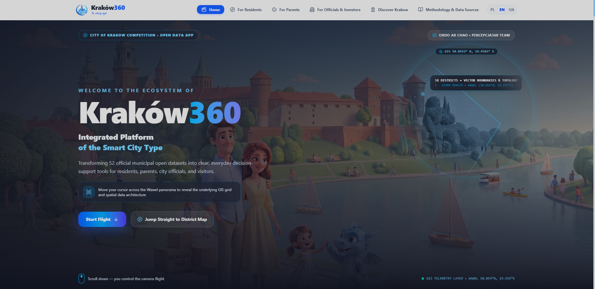
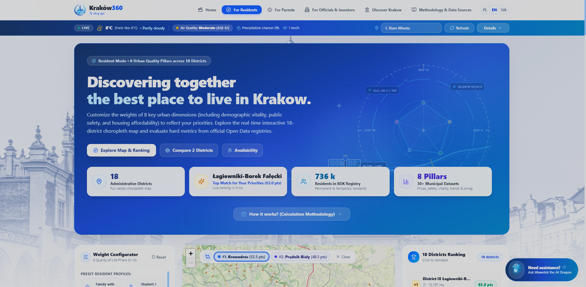
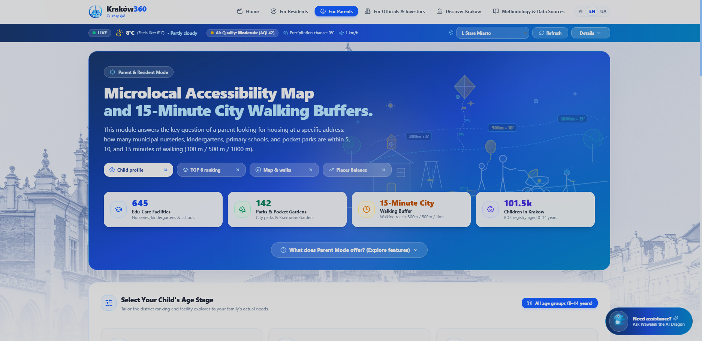
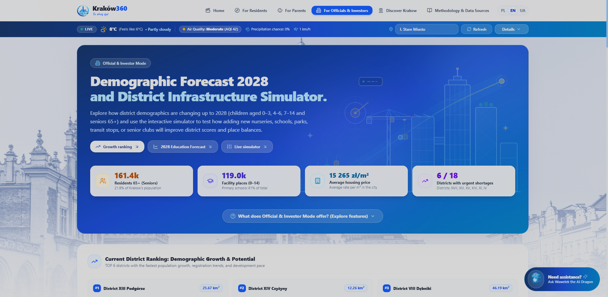
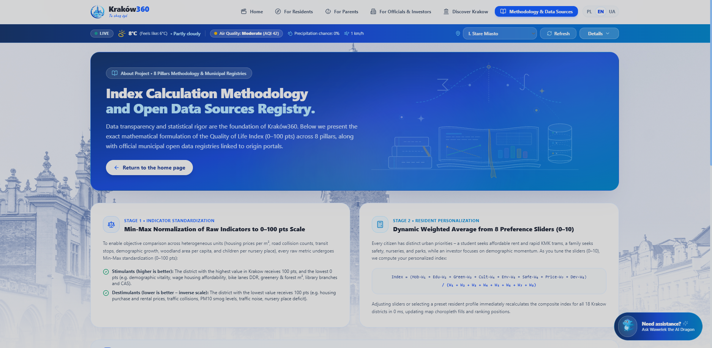
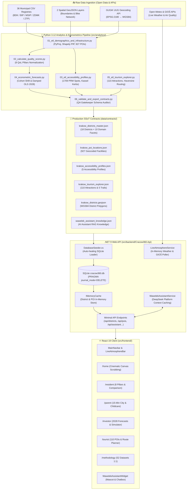
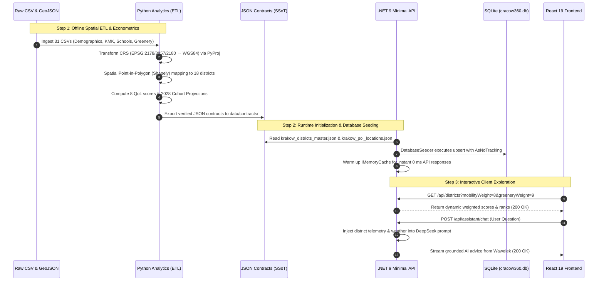

# 🏙️ Kraków360 - Integrated Quality of Life Analysis, Service Accessibility, and Urban Development Prediction System

> 🌐 **Documentation in two languages / Dokumentacja w dwóch językach:**  
> 🇬🇧 **English (Current)** | 🇵🇱 **[Polski (README-pl.md)](./README-pl.md)**

[](https://kraków360.pl)
[](https://dotnet.microsoft.com/)
[](https://react.dev/)
[](https://tailwindcss.com/)
[](https://www.python.org/)
[](https://sqlite.org/)
[](https://www.docker.com/)
[](https://otwartedane.um.krakow.pl/)

---

<video src="https://github.com/user-attachments/assets/c30190d3-29c7-4377-ae67-a6c61a1833fe" controls autoplay loop muted width="100%">
</video>

---

## 🧭 Executive Summary & Core Mission

> *"Ordo ab chao"* - *Order from chaos.*

**Kraków360** is an advanced, high-performances Smart City decision-support platform designed and engineered for the official **"Open Data App" competition** organized by the **Municipality of Krakow** (*Gmina Miejska Kraków - Centrum Obsługi Informatycznej, Wydział ds. Smart City i Analizy Danych*) in collaboration with **AGH University of Krakow** and **Cracow University of Technology**.

Modern Krakow generates hundreds of raw data files spanning demographics, public transit, education, public safety, air quality, sports facilities, and municipal budgets. However, prior to Kraków360, this vast ocean of information remained fragmented across siloed spreadsheets, PDF reports, and disparate departmental portals.

**Kraków360 transforms this raw data into an actionable, live ecosystem for four key audiences:**
1. **Residents & House Hunters:** An instant, personalized Quality of Life Index (0–100 pts) across 8 urban dimensions, real-time 18-district choropleths, 1:1 radar comparison tools, and the *"Kraków Without Barriers"* accessibility audit.
2. **Young Parents & Families:** A strict 15-Minute City walking simulator with 788 geocoded educational and recreational POIs, 300m/500m/1km isochrones, and detailed nursery/kindergarten vacancy balances.
3. **City Officials & Public/Private Investors:** Horizon 2028 demographic cohort forecasts (0–3, 4–6, 7–14, 65+) combined with a 14-counter interactive Infrastructure Expansion Simulator ("What-If") computing real-time rank gains and seat deficits.
4. **Tourists & Heritage Explorers:** 110 audited attractions across all 18 districts, an automated Haversine itinerary planner with *District-First Chaining*, 18 District Transit Passports, and an *Overtourism Compass* diverting foot traffic away from congested city center hotspots.

### 📊 Grounded in Empirical Research: Survey of 243 Residents
Before writing a single line of application code, **Team Percepcja360** conducted an empirical survey of **243 Krakow residents** across all 18 districts. The findings revealed three massive civic bottlenecks:
- **87.2%** of respondents struggled to compare neighborhoods objectively before signing lease agreements or buying homes.
- **76.5%** of parents reported that official municipal lists of nurseries and kindergartens gave no clear view of real walking distance or current seat surpluses/deficits.
- **91.4%** desired a single civic portal combining live air quality telemetry, neighborhood safety ratings, and public transit connectivity without navigating multiple municipal portals.

Kraków360 directly implements the strategic goals of the **Krakow Development Strategy: *"Tu chcę żyć. Kraków 2030"*** (15-minute city accessibility, sustainable mobility, balanced childcare provision, social inclusion, and sustainable smart tourism).

---

## 📑 Table of Contents

- [🌐 Live Demonstration & Production Links](#-live-demonstration--production-links)
- [✨ Interactive Modules & Feature Walkthrough](#-interactive-modules--feature-walkthrough)
  - [1. 🎬 Cinematic Showcase & Storytelling (`/home`)](#1--cinematic-showcase--storytelling-home)
  - [2. 🏡 Resident Mode & 8-Pillar QoL Engine (`/resident`)](#2--resident-mode--8-pillar-qol-engine-resident)
  - [3. 👶 Parent Mode & 15-Minute City Simulator (`/parent`)](#3--parent-mode--15-minute-city-simulator-parent)
  - [4. 🏛️ Official & Investor Mode (`/investor`)](#4--official--investor-mode-investor)
  - [5. 🧭 Smart Tourism & Overtourism Relief (`/tourist`)](#5--smart-tourism--overtourism-relief-tourist)
  - [6. 🔬 Methodology & Open Data Registry (`/methodology`)](#6--methodology--open-data-registry-methodology)
  - [7. 🌤️ Live Atmospheric & Air Quality Telemetry Bar](#7--live-atmospheric--air-quality-telemetry-bar)
  - [8. 🐉 Wawelek AI Assistant & City Companion](#8--wawelek-ai-assistant--city-companion)
- [🏗️ System Architecture & Engineering](#-system-architecture--engineering)
  - [Complete System Architecture](#complete-system-architecture)
  - [End-to-End Data Pipeline](#end-to-end-data-pipeline)
  - [Entity Relationship Diagram (ERD)](#entity-relationship-diagram-erd)
  - [Backend Clean Architecture (.NET 9)](#backend-clean-architecture-net-9)
  - [Frontend Architecture (React 19)](#frontend-architecture-react-19)
- [📁 Repository & Directory Structure](#-repository--directory-structure)
- [📐 Open Data Integration & Mathematical Foundations](#-open-data-integration--mathematical-foundations)
  - [Spatial GIS Projections](#spatial-gis-projections)
  - [Poisson Public Transit 15-Minute Isochrone](#poisson-public-transit-15-minute-isochrone)
  - [8-Pillar Quality of Life Normalization](#8-pillar-quality-of-life-normalization)
  - [Demographic Cohort Shift & OLS Damped Forecasting (2028)](#demographic-cohort-shift--ols-damped-forecasting-2028)
- [🚀 Quick Start & Deployment Guide](#-quick-start--deployment-guide)
  - [Option A: Docker Compose (Production / Full Stack)](#option-a-docker-compose-production--full-stack)
  - [Option B: Manual Development Setup (.NET 9 + Node.js + Python)](#option-b-manual-development-setup-net-9--nodejs--python)
  - [Environment Variables](#environment-variables)
  - [Service Endpoints & Ports](#service-endpoints--ports)
- [🧪 Quality Assurance & System Verification](#-quality-assurance--system-verification)
- [👥 Team Percepcja360 & Authors](#-team-percepcja360--authors)
- [📄 License & Disclaimers](#-license--disclaimers)

---

## 🌐 Live Demonstration & Production Links

The production version of Kraków360 is deployed on high-availability infrastructure (VPS Mikrus + NGINX + Docker) and fully accessible online:

- 🚀 **Live Production Application:** [https://kraków360.pl](https://kraków360.pl)
- 🎥 **Cinematic Promo Video (2 min):** [`Assets/Videos/ad.mp4`](./Assets/Videos/ad.mp4)
- 🚁 **Aerial Drone Panorama:** [`Assets/Videos/panorama.mp4`](./Assets/Videos/panorama.mp4)

---

## ✨ Interactive Modules & Feature Walkthrough

### 1. 🎬 Cinematic Showcase & Storytelling (`/home`)
*An immersive visual narrative introducing Kraków360 via state-of-the-art web performance.*



- **Act I: Interactive "Dual-Vision" Hero Lens (`HeroDualVisionMask.tsx`):**
  - A dynamic dark canvas with cartographic grid coordinates of Wawel Castle (`50.054° N, 19.935° E`).
  - An interactive 280-pixel circular cursor lens powered by spring physics: hovering across the screen wipes away chaotic raw spreadsheets to reveal the crisp, modern Kraków360 analytical interface.
- **Act II: HTML5 Canvas Scroll-Scrubbing (`VelocityScrollScrubSection.tsx`):**
  - A pinned sticky stage rendering a frame-by-frame 720p drone flight over Krakow's skyline using a unified HTML5 `<canvas>`.
  - Velocity-clamped scroll smoothing prevents texture tearing or frame dropping.
  - **8 Choreographed 3D Story Chapters:** Alternates dynamically from left to right on desktop with 3D perspective pitch/yaw rotations, detailing project genesis, resident findings, parent simulation, and AI capabilities.
  - **Autopilot Flight Mode:** An interactive audio-synced automated flight option (`panorama-audio.mp3`) with instant per-frame scrolling.
  - Smooth finale transition: progressive blur and pure white dissolve into the transparent *Ordo ab chao* insignia.
- **Act III: Spotlight Video Card & Bento Hub (`PromoVideoSpotlightCard.tsx` & `FinaleSection.tsx`):**
  - High-definition trailer player with a custom microphone cursor toggle (mute/unmute).
  - Live metric counters sourced from the SQLite database and a symmetrical Bento navigation grid routing directly into the analytical modules.

---

### 2. 🏡 Resident Mode & 8-Pillar QoL Engine (`/resident`)
*Personalized neighborhood discovery powered by transparent multi-criteria mathematics.*



- **Real-Time Quality of Life Calculator (0 ms latency):**
  - Computes a weighted index (0.0 to 100.0) across **8 urban dimensions** for all 18 districts simultaneously.
  - Sliders (0–10) with cubic gliding physics and 6 instant resident profiles: *Family with Children, Student / Young Professional, Active Senior, Remote Worker, Eco Cyclist, and Real Estate Investor*.
- **Interactive Vector Choropleth Map:**
  - Real-time color-coded boundaries (WGS84 EPSG:4326) with custom tooltips, popups, and district boundary zooming.
- **1:1 District Head-to-Head Comparison Drawer:**
  - Dynamic **8-axis Radar Chart** comparing strengths and weaknesses between any two selected districts.
  - Table of **verified municipal indicators** with difference badges and horizontal touch-pan scrolling for smartphones.
- **"Kraków Without Barriers" (*Kraków bez Barier*) Accessibility Module:**
  - 5 tailored accessibility profiles: *Wheelchair / Reduced Mobility, Blind / Visual Impairment, Deaf / Hearing Impairment, Seniors, and Strollers*.
  - Aggregates **1,709 PRM parking bays across 927 locations**, Kassel-kerb step-free transit platforms, tactile paving, and architectural accessibility audits of **25 public municipal buildings**.

---

### 3. 👶 Parent Mode & 15-Minute City Simulator (`/parent`)
*Comprehensive spatial analysis of early childcare, schooling, and family living standards.*



- **15-Minute City Walking Buffer Generator:**
  - Generates precise circular walking buffers (300 m, 500 m, 1 km) using the Haversine metric from any point on the map.
- **Age-Cohort Personalization:**
  - Select between **0–3 years** (nurseries & toddler clubs), **4–6 years** (kindergartens), **7–14 years** (primary schools), or **All Groups**.
  - Dynamic TOP 6 district ranking tailored to the chosen age bracket.
- **788 Geocoded Educational & Recreational POIs:**
  - Displays public and private nurseries, subsidized toddler clubs, kindergartens, primary schools, playgrounds, and parks with exact coordinates resolved via GUGiK EMUiA and OpenStreetMap.
- **7-Module Childcare Balance Drawer:**
  - Real-time arithmetic balance: statutory capacity vs. currently enrolled children vs. vacant seats vs. resident child population.
  - Searchable live registry of **645 educational institutions** with instant text filtering.

---

### 4. 🏛️ Official & Investor Mode (`/investor`)
*Demographic forecasting, municipal gap analysis, and interactive "What-If" infrastructure simulation.*



- **Section 1: Demographic Vitality & Settlement Dynamics (TOP 6):**
  - Ranks districts by 3-year population growth rate, share of working-age population (15–64), and attractiveness to international and temporary residents.
- **Section 2: Horizon 2028 Cohort Projections & Infrastructure Gaps:**
  - Ekonometric predictions of future school-age cohorts (0–3, 4–6, 7–14) to identify emerging seat shortages before they impact families.
- **Section 3: 14-Counter Interactive Infrastructure Expansion Simulator ("What-If"):**
  - Allows planners to simulate additions across 4 municipal categories:
    1. *Education & Family:* New nurseries (+100 seats), kindergartens (+125 seats), primary schools (+400 seats), Parent Clubs.
    2. *Greenery & Sports:* Pocket parks (+0.25 ha), municipal parks (+2.0 ha), sports fields & school swimming pools.
    3. *Public Transit & Cycling:* Bus stops, tram stops, bike lanes (+1 km), Park & Ride hubs (+150 spots, +15 bike racks).
    4. *Seniors & Culture:* Senior Activity Centers (CAS), Library branches, Community Cultural Centers.
  - **4 Instant Test Packages:** *Family & Kids, Green District, Transit Boost, and Senior & Culture*.
  - **Live Impact Recalculation:** Instantly displays rank advancement (`#Before -> #After / 18`), composite score changes, 2028 seat deficit adjustments, and green area per capita gains.

---

### 5. 🧭 Smart Tourism & Overtourism Relief (`/tourist`)
*Decongesting the historical core while unlocking cultural heritage across all 18 districts.*


- **110 Audited Attractions Across All 18 Districts:**
  - Guarantees at least 6–7 curated cultural, historical, and natural POIs per district, integrated with official 2024 tourism telemetry (14.72 million visitors).
- **Intelligent Route Planner (Haversine & District-First Chaining):**
  - Custom itineraries tailored to 4 time budgets (2h, 4h, 6h, full-day) and 6 thematic profiles (*Historic Icons, Green Nature, Modernist Architecture, Families with Kids, Artistic Krakow, Off-the-Beaten-Path*).
  - Automatically calculates walking segments, tram connections, and duration.
- **Overtourism Relief Compass:**
  - 5 curated alternative pairs diverting crowds from saturated landmarks (Wawel Castle, Main Market Square, Kazimierz) to high-quality, authentic alternatives (Kopiec Piłsudskiego, Dworek Białoprądnicki, Nowa Huta Centralny Plac, Zalew Nowohucki).
- **18 District Transit Passports:**
  - Complete mobility cheat-sheets: direct tram and bus lines from Krakow Main Railway Station (*Dworzec Główny*), transit duration, and local bike infrastructure.

---

### 6. 🔬 Methodology & Open Data Registry (`/methodology`)
*Full scientific transparency, mathematical formulations, and promoted open data portal links.*



- **1:1 Registry of 52 Raw Municipal Datasets:**
  - Detailed catalog of every integrated CSV and GeoJSON file, describing update frequency, administrative publisher, and processing rules.
- **Mathematical Formulations:**
  - Transparent documentation of Min-Max normalization, stimulants vs. destimulants, and Poisson distribution models.
- **Promoted Krakow Open Data Portal (`otwartedane.um.krakow.pl`):**
  - Highlights city datasets with badges and direct portal links, encouraging open-data civic engagement.

---

### 7. 🌤️ Live Atmospheric & Air Quality Telemetry Bar
*Real-time ambient monitoring integrated directly below the top navigation bar.*

<video src="https://github.com/user-attachments/assets/fa5b4668-6ca6-454a-aa7d-c4f23017075f" controls autoplay loop muted width="100%">
</video>

- **Live Meteorological Telemetry (Open-Meteo API):** Real-time ambient readings including temperature, apparent feel (°C), dynamic WMO weather condition icons, precipitation probability, and wind velocity with localized gust tracking.
- **Air Quality & Smog Telemetry (GIOŚ & Copernicus CAMS Grid):** European Air Quality Index (EAQI), real-time PM10, PM2.5, NO₂ concentrations, and 90-day winter smog exceedance thresholds.
- **Health, UV & Botanical Allergen Alerts:** Real-time monitoring across 5 botanical allergens (grass, birch, alder, mugwort, ambrosia) and UV Index warnings to assist sensitive residents and allergy sufferers.
- **Interactive 24-Hour Trend Slider:** High-precision expandable drawer rendering interactive hourly temperature curves and precipitation bar charts (Recharts) for seamless day-ahead planning.
- **Fault-Tolerant In-Memory Caching & Resiliency:** Background telemetry engine with SWR (Stale-While-Revalidate) caching to ensure instant 0 ms client-side delivery and offline resilience even during external provider latency spikes.

---

### 8. 🐉 Wawelek AI Assistant & City Companion
*A friendly, context-grounded conversational agent powered by DeepSeek API & RAG.*

<video src="https://github.com/user-attachments/assets/7ba3731a-7d9f-481c-bff4-6ee21269bfcb" controls autoplay loop muted width="100%">
</video>

- **Floating Action Button (FAB) & Mascot Avatar (`WawelekAssistantWidget.tsx`):**
  - Positioned at the bottom-right of the viewport with an ambient glow aura and animated SVG Mascot Avatar reacting dynamically to 4 distinct emotional states: `idle`, `listening`, `thinking`, and `speaking`.
- **RAG Architecture with Live Municipal Grounding:**
  - Directly grounded in the verified SSoT database (`krakow_districts_master.json`, `wawelek_assistant_knowledge.json`), active district scores, and live atmospheric telemetry to prevent out-of-domain hallucinations.
- **DeepSeek V3 LLM Orchestration & Context Caching:**
  - Integrates the high-speed `deepseek-chat` model with DeepSeek Context Caching over static civic knowledge, reducing recurring API latency by up to 80% and ensuring cost-effective inference.
- **Strict Municipal Guardrails & Bilingual Reasoning:**
  - Formatted with rigorous system instructions: answers questions in Polish or English, quotes exact civic statistics, guides users to relevant platform modules, and gracefully declines speculative or unrelated queries.

---

## 🏗️ System Architecture & Engineering

### Complete System Architecture



---

### End-to-End Data Pipeline



---

### Entity Relationship Diagram (ERD)

```mermaid
erDiagram
    DISTRICT ||--|{ POINT_OF_INTEREST : contains
    DISTRICT ||--|| DISTRICT_SCORES : has
    DISTRICT ||--|| DISTRICT_DEMOGRAPHICS : has
    DISTRICT ||--|| DISTRICT_EDUCATION : has
    DISTRICT ||--|| DISTRICT_MOBILITY : has
    DISTRICT ||--|| DISTRICT_GREENERY : has
    DISTRICT ||--|| DISTRICT_CULTURE : has
    DISTRICT ||--|| DISTRICT_SAFETY : has
    DISTRICT ||--|| DISTRICT_HOUSING : has
    DISTRICT ||--|| DISTRICT_ENVIRONMENT : has
    DISTRICT ||--|| DISTRICT_FORECASTS : has

    DISTRICT {
        int DistrictId PK "1 to 18"
        string DistrictRoman "I to XVIII"
        string DistrictName "e.g. Stare Miasto"
        double AreaKm2 "Official area in km²"
    }

    DISTRICT_SCORES {
        double OverallScore "0.0 - 100.0"
        double MobilityScore
        double EducationScore
        double GreeneryScore
        double CultureAndSeniorScore
        double EnvironmentScore
        double SafetyScore
        double HousingAffordabilityScore
        double DemographicVitalityScore
    }

    DISTRICT_DEMOGRAPHICS {
        int TotalPopulation "736,035 city total"
        int PermanentResidents
        int TemporaryResidents
        int ForeignersTotal "12,066 city total"
        int Age0to3
        int Age4to6
        int Age7to14
        int Age65Plus
        double PopulationGrowthRate3YrPct
    }

    DISTRICT_EDUCATION {
        int NurseriesPublicCount
        int NurseriesPrivateCount
        int TotalCarePlaces0to3
        double ChildrenPerCarePlaceRatio
        int KindergartenPlacesTotal
        int PrimarySchoolsCount
        double AvgStudentsPerClass
    }

    DISTRICT_MOBILITY {
        int KmkStopsCount
        int TramStopsCount
        double TramNetworkSharePct
        double IsochroneCoveragePct "500m model"
        double BikeLanesLengthKm
        int BikeRacksCount
        int ParkAndRideCount
    }

    DISTRICT_GREENERY {
        int CityParksCount
        int PocketParksCount
        double TotalParksAreaHa
        double ForestAreaHa
        double TotalGreenAreaHa
        double TotalGreenM2PerCapita
        int SchoolSportsFacilitiesCount
        int SchoolSwimmingPoolsCount
    }

    POINT_OF_INTEREST {
        string Id PK "Deterministic string key"
        int DistrictId FK "1 to 18"
        string Name "Facility Name"
        string Address "Street and building"
        double Latitude "WGS84"
        double Longitude "WGS84"
        string Category "EDU_CARE | GREENERY | MOBILITY | CULTURE"
    }
```



---

### Backend Clean Architecture (.NET 9)

The backend is built following **Clean Architecture** principles, maintaining strict separation of concerns across four projects in `src/backend/`:

1. **`Cracow360.Domain`**:
   - Aggregate roots (`District`), entities (`PointOfInterest`, `AirQualityStationReading`), and strongly-typed owned value objects.
   - Enums: `PoiCategory`, `InvestmentPotential`, `DistrictTier`.
   - Domain logic: `CalculateWeightedQualityOfLifeIndex(...)` pure mathematical calculation without framework dependencies.
2. **`Cracow360.Application`**:
   - DTOs (`DistrictSummaryDto`, `DistrictDetailDto`, `PoiDto`, `AccessibilityDto`, `TourismDto`, `LiveAtmosphereDto`, `WawelekChatDto`).
   - Service interfaces (`IDistrictService`, `IPoiService`, `ILiveAtmosphereService`, `IAccessibilityService`, `ITourismService`, `IWawelekAssistantService`).
3. **`Cracow360.Infrastructure`**:
   - EF Core 9 `Cracow360DbContext` with owned entity configurations mapped to SQLite.
   - `DatabaseSeeder.cs` featuring **Self-Healing schema verification** (detects column mismatches, clears change trackers, and ingests contracts).
   - High-performance caching via `IMemoryCache` and `Dapper` read queries.
   - External service implementations: `LiveAtmosphereService` (Open-Meteo & GIOŚ) and `WawelekAssistantService` (DeepSeek Platform API with Context Caching).
4. **`Cracow360.Api`**:
   - High-throughput ASP.NET Core 9 **Minimal API** endpoint route groups.
   - Built-in rate limiting (`FixedWindowRateLimiter`), CORS policies, Swagger OpenAPI generation, and `/health` probes.

---

### Frontend Architecture (React 19)

The client application is built with **React 19** and **Vite 6** in `src/frontend/`:
- **State Management:** Zero bloated external state libraries; uses lightweight, reactive React 19 hooks (`useState`, `useMemo`, `useCallback`, `useRef`) ensuring instantaneous 0 ms re-renders during slider interactions.
- **Styling:** **TailwindCSS v4** with native CSS variables, custom smooth bezier easings, and `@supports (max-height: 100dvh)` viewport constraints.
- **Cartography:** **React-Leaflet v5** rendering vector GeoJSON district boundaries, custom SVG markers, and live radius circle buffers.
- **Data Visualization:** **Recharts** delivering responsive 8-axis Radar charts, 24h temperature/rain bar charts, and horizontal indicator bars.
- **Internationalization (i18n):** Complete trilingual support across **Polish (PL)**, **English (EN)**, and **Ukrainian (UA)** with seamless runtime switching.

---

## 📁 Repository & Directory Structure

```mermaid
flowchart TD
    ROOT["📁 cracow360/ (Repository Root)"]

    %% Top-Level Sections
    ROOT --> ASSETS["📁 Assets/"]
    ROOT --> DATA["📁 data/"]
    ROOT --> SRC["📁 src/"]
    ROOT --> ROOT_FILES["⚙️ Root Configs<br/><code>docker-compose.yml, README*.md</code>"]

    %% Assets
    ASSETS --> A_IMG["🖼️ Images/ <i>(Screenshots & badges)</i>"]
    ASSETS --> A_VID["🎬 Videos/ <i>(Promo trailer & panorama)</i>"]
    ASSETS --> A_AUD["🎵 Audio/ <i>(Flight soundtrack)</i>"]

    %% Data
    DATA --> D_CON["📜 contracts/ <i>(SSoT JSON schemas & data)</i>"]
    DATA --> D_DB["🗄️ db/ <i>(SQLite operational store)</i>"]

    %% Src Modules
    SRC --> S_AN["🐍 analytics/ <i>(Python 3.12 ETL & Models)</i>"]
    SRC --> S_BE["🔷 backend/ <i>(.NET 9 Minimal API)</i>"]
    SRC --> S_FE["⚛️ frontend/ <i>(React 19 & TypeScript)</i>"]

    %% Analytics Breakdown
    S_AN --> AN_RAW["📁 data_raw/ <i>(36 Raw CSV files)</i>"]
    S_AN --> AN_PROC["📁 data_processed/ <i>(Intermediate staging)</i>"]
    S_AN --> AN_SCR["📁 scripts/ <i>(01–06 ETL & QA pipeline)</i>"]
    S_AN --> AN_CH["📁 charts/ <i>(Generated visual charts)</i>"]

    %% Backend Clean Architecture
    S_BE --> BE_DOM["📦 Cracow360.Domain <i>(Entities & QoL logic)</i>"]
    S_BE --> BE_APP["📦 Cracow360.Application <i>(DTOs & Service contracts)</i>"]
    S_BE --> BE_INF["📦 Cracow360.Infrastructure <i>(EF Core, Seeder, DeepSeek)</i>"]
    S_BE --> BE_API["📦 Cracow360.Api <i>(Minimal API Endpoints & Config)</i>"]

    %% Frontend Modular Structure
    S_FE --> FE_PAGES["📁 pages/ <i>(6 Mode Views: Home, Resident, Parent...)</i>"]
    S_FE --> FE_COMP["📁 components/ <i>(Atmosphere, AI, Leaflet, Recharts)</i>"]
    S_FE --> FE_I18N["📁 i18n/ <i>(Trilingual dictionaries: PL, EN, UA)</i>"]
    S_FE --> FE_SERV["📁 services/ & types/ <i>(API client & contracts)</i>"]
```



```text
cracow360/
├── Assets/                        # Visual media and promotional assets
│   ├── Audio/                     # Background flight soundtrack (panorama-audio.mp3)
│   ├── Images/                    # Documentation figures, UI screenshots & banners
│   └── Videos/                    # High-definition showcase trailer & drone panorama
├── data/                          # Data persistence and single source of truth contracts
│   ├── contracts/                 # SSoT JSON datasets (demographics, POIs, tourism, accessibility)
│   └── db/                        # Operational SQLite database file (cracow360.db)
├── src/                           # Complete application source code
│   ├── analytics/                 # Python 3.12 Data Science, GIS & Econometrics Pipeline
│   │   ├── charts/                # Generated publication-quality analytical charts
│   │   ├── data_processed/        # Intermediate geocoded staging buffer & cache
│   │   ├── data_raw/              # 36 immutable raw municipal CSV registries & GeoJSONs
│   │   ├── scripts/               # 6-step sequential ETL, GIS projection & QA pipeline
│   │   └── requirements.txt       # Python environment dependencies
│   ├── backend/                   # .NET 9 C# Clean Architecture Backend Solution
│   │   ├── Cracow360.Domain/          # Core entities, value objects & pure mathematical formulas
│   │   ├── Cracow360.Application/     # Service interfaces, DTOs & business application logic
│   │   ├── Cracow360.Infrastructure/  # EF Core, SQLite seeder, DeepSeek AI & Live Atmosphere services
│   │   ├── Cracow360.Api/             # High-throughput ASP.NET Core 9 Minimal API endpoints
│   │   └── Cracow360.sln              # Visual Studio / Rider solution file
│   └── frontend/                  # React 19 + TypeScript + Vite 6 Modern Web Client
│       ├── public/                # Static assets, favicon and icons
│       ├── src/
│       │   ├── components/        # Modular UI components (Atmosphere, AI Assistant, Maps, Drawers)
│       │   ├── i18n/              # Complete trilingual localization (PL, EN, UA)
│       │   ├── pages/             # 6 primary analytical mode views (/home, /resident, /parent...)
│       │   ├── services/          # REST API communication client & caching layer
│       │   ├── types/             # TypeScript interfaces mapping SSoT contract schemas
│       │   └── index.css          # TailwindCSS v4 design tokens and smooth transitions
│       ├── package.json           # Frontend dependencies and build scripts
│       └── vite.config.ts         # Vite bundler configuration & proxy rules
├── docker-compose.yml             # Multi-stage production container orchestration
├── README.md                      # English documentation & technical specifications
└── README-pl.md                   # Polish documentation & technical specifications
```

---

## 📐 Open Data Integration & Mathematical Foundations

### Spatial GIS Projections
Raw municipal registries in Krakow are distributed in heterogeneous coordinate systems. The Python ETL pipeline (`01_etl_demographics_and_infrastructure.py`) utilizes `pyproj.Transformer` to project all geometries into uniform **WGS84 (`EPSG:4326`)**:
- ZTP Bicycle Racks: `EPSG:2178` (PUWG 2000 zone 7) $\rightarrow$ `EPSG:4326`.
- Public Transit Stops: `EPSG:3857` (Spherical Web Mercator) $\rightarrow$ `EPSG:4326`.
- GUGiK Geocoding: `EPSG:2180` (PUWG 1992) $\rightarrow$ `EPSG:4326`.

### Poisson Public Transit 15-Minute Isochrone
Transit stop accessibility is modeled via a spatial Poisson distribution over a 500-meter walking radius ($r = 0.5\text{ km}$):

$$\lambda_{\text{eff}} = 0.35 \times \frac{N_{\text{stops}}}{A_{\text{district}}}$$

$$\text{TransitCoverage}_{500\text{m}} = \min\left(99.5,\; \left(1 - e^{-\lambda_{\text{eff}} \cdot \pi r^2}\right) \times 100\right)$$

### 8-Pillar Quality of Life Normalization
Each pillar score $S_i \in [0.0, 100.0]$ is normalized against official international or national standards (WHO, EEA, GUS) using Min-Max scaling:

- **Stimulants (higher is better):**
  $$S = \text{clamp}\left(\frac{x - x_{\min}}{x_{\max} - x_{\min}} \times 100\right)$$
- **Destimulants (lower is better, e.g. air pollution, traffic collisions):**
  $$S = \text{clamp}\left(\left(1 - \frac{x - x_{\min}}{x_{\max} - x_{\min}}\right) \times 100\right)$$

The composite Quality of Life Index is calculated dynamically using the user's custom weights $w_i \in [0, 10]$:

$$\text{QoL Index} = \frac{\sum_{i=1}^{8} S_i \cdot w_i}{\sum_{i=1}^{8} w_i}$$

### Demographic Cohort Shift & OLS Damped Forecasting (2028)
To predict age-cohort populations for 2028 ($t+3$), we combine cohort aging with an ordinary least squares (OLS) historical trend damped by $\phi = 0.65$:

$$\hat{P}_{c, 2028} = P_{c-3, 2025} \cdot (1 + \phi \cdot \Delta_{\text{mig, 3yr}})$$

---

## 🚀 Quick Start & Deployment Guide

### Option A: Docker Compose (Production / Full Stack)
*The fastest, fully automated way to run Kraków360 on any system with Docker installed.*

```bash
# 1. Clone the repository
git clone https://github.com/zephir-x/cracow360.git
cd cracow360

# 2. (Optional) Provide your DeepSeek API key for Wawelek AI
echo "DEEPSEEK_API_KEY=your_key_here" > .env

# 3. Build and launch all multi-stage containers
docker compose up --build -d

# 4. Open the application in your browser:
# Frontend -> http://localhost:80
# Backend API -> http://localhost:5000/swagger
```

---

### Option B: Manual Development Setup (.NET 9 + Node.js + Python)
*Recommended for local development, code debugging in Rider/VS Code, and running the ETL scripts.*

#### Step 1: Prerequisites
- [.NET 9.0 SDK](https://dotnet.microsoft.com/download/dotnet/9.0)
- [Node.js 20+ LTS & npm](https://nodejs.org/)
- [Python 3.11+](https://www.python.org/downloads/)

#### Step 2: (Optional) Run the Analytics Pipeline
*Pre-computed contract JSON files are already committed to `data/contracts/`. If you want to re-run the pipeline from raw CSVs:*

```bash
# Create and activate Python virtual environment
python -m venv .venv
# Windows:
.venv\Scripts\activate
# Linux/macOS:
source .venv/bin/activate

# Install analytics dependencies
pip install -r src/analytics/requirements.txt

# Run all 6 pipeline steps sequentially
python src/analytics/scripts/01_etl_demographics_and_infrastructure.py
python src/analytics/scripts/02_calculate_quality_scores.py
python src/analytics/scripts/03_etl_accessibility_profiles.py
python src/analytics/scripts/04_econometric_forecasts.py
python src/analytics/scripts/05_etl_tourism_explorer.py
python src/analytics/scripts/06_validate_and_export_contracts.py
```

#### Step 3: Launch .NET 9 Backend Web API
```bash
# Start backend API (seeds SQLite database automatically from data/contracts/)
dotnet run --project src/backend/Cracow360.Api/Cracow360.Api.csproj

# Backend will be listening on:
# http://localhost:5000
# Swagger UI -> http://localhost:5000/swagger
```

#### Step 4: Launch React 19 Frontend
```bash
# Open a new terminal window
cd src/frontend

# Install dependencies and start Vite dev server
npm install
npm run dev

# Frontend will be listening on:
# http://localhost:5173
```

---

### Environment Variables

| Variable | Target | Description | Default |
| :--- | :--- | :--- | :--- |
| `ASPNETCORE_ENVIRONMENT` | Backend | Runtime mode (`Development` / `Production`) | `Development` |
| `ConnectionStrings__DefaultConnection` | Backend | SQLite connection string | `Data Source=../../data/db/cracow360.db` |
| `DEEPSEEK_API_KEY` | Backend | DeepSeek Platform API Key for Wawelek AI | *(Empty / mock mode)* |
| `DEEPSEEK_MODEL` | Backend | LLM Model name | `deepseek-chat` |
| `VITE_API_BASE_URL` | Frontend | Target API endpoint for client requests | `http://localhost:5000` |

---

### Service Endpoints & Ports

| Service | Port | Local URL | Description |
| :--- | :---: | :--- | :--- |
| **Frontend UI (Vite Dev)** | `5173` | `http://localhost:5173` | Interactive React 19 Client |
| **Frontend UI (Docker)** | `80` | `http://localhost:80` | Production NGINX web server |
| **Backend API (.NET 9)** | `5000` | `http://localhost:5000` | Minimal API & Business Logic |
| **Swagger UI** | `5000` | `http://localhost:5000/swagger` | Interactive OpenAPI 3.0 Explorer |
| **Health Check** | `5000` | `http://localhost:5000/health` | Container liveness & readiness probe |

---

## 🧪 Quality Assurance & System Verification

The repository incorporates multiple layers of automated verification:

1. **Gatekeeper QA Schema Validator (`06_validate_and_export_contracts.py`):**
   - Validates data types, non-null assertions, coordinate bounding boxes (Krakow bounding box: `50.00°N - 50.15°N, 19.80°E - 20.15°E`), and sum consistency across all 18 districts.
2. **Database Self-Healing Verification (`DatabaseSeeder.cs`):**
   - Automatically inspects the SQLite database schema on startup, checks column alignment against domain models, and transparently re-seeds data from `data/contracts/` if anomalies are found.
3. **Frontend Compilation & Type Safety:**
   - Strict TypeScript configuration (`tsc -b`) and Vite production bundle optimization (`npm run build`) executing with **0 errors**.

---

## 👥 Team Percepcja360 & Authors

| Contributor | Academic Background | Project Responsibilities |
| :--- | :--- | :--- |
| **Kacper Gumulak**<br/>*Lead Architect & Fullstack Software Engineer* | Computer Science<br/>**Cracow University of Technology** (*Politechnika Krakowska*)<br/>[LinkedIn Profile](https://www.linkedin.com/in/kacper-gumulak-532a6b290/) | Software engineering, .NET 9 Minimal API, React 19 Frontend, Leaflet cartography, Canvas scroll scrubbing, SQLite seeder, DeepSeek AI integration, Docker DevOps. |
| **Filip Gorczyca**<br/>*Lead Data Analyst, Econometrics & Visual Design* | Economic Analysis<br/>**Krakow University of Economics** (*Uniwersytet Ekonomiczny w Krakowie*)<br/>[LinkedIn Profile](https://www.linkedin.com/in/filip-gorczyca-4469a4309/) | Municipal open data calibration, econometric models, empirical survey of 243 residents, brand identity, video production (`ad.mp4`, `panorama.mp4`), and competition documentation. |

---

## 📄 License & Disclaimers

- **Open Municipal Data:** All raw municipal datasets, spatial layers, and statistical records are publicly accessible under Open Data principles and public sector information re-use standards courtesy of the **Municipality of Krakow** (*Gmina Miejska Kraków*), **BDK**, **ZTP**, **ZZM**, **ZDMK**, **GIOŚ**, and **GUGiK**.
- **Visual Media & Algorithmic Media Synthesis:** Video sequences (including aerial panoramas and promotional showcases) and select digital illustrations were produced through state-of-the-art computational neural rendering pipelines and generative media synthesis under direct human creative direction, styling, and post-production curation by Team Percepcja360.
- **Stock Photography & Graphics:** Select background textures and photographic elements were acquired from [Pixabay.com](https://pixabay.com) under the royalty-free Pixabay Content License (free for commercial and non-commercial use with no attribution required).
