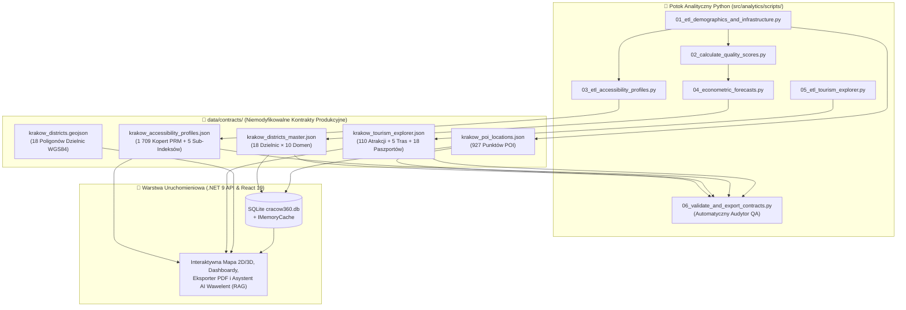

# 📜 Cracow360 — Finalne Kontrakty Analityczne (`data/contracts/`)

> 🌐 **Dokumentacja w dwóch językach / Documentation in two languages:**  
> 🇬🇧 **[English (README.md)](./README.md)** | 🇵🇱 **Polski (Aktualny)**

-2563EB?style=for-the-badge)
-F59E0B?style=for-the-badge&logo=json&logoColor=white)

---

## 📌 Rola Architektoniczna

Ten katalog stanowi **Jedyne Źródło Prawdy (Single Source of Truth — SSoT)** łączące offline'owy **potok analityczno-ekonometryczny Python** ([`src/analytics/scripts/`](../../src/analytics/scripts/README-pl.md)) z produkcyjnym stosem uruchomieniowym (**.NET 9 Web API** oraz **React 19 Frontend**).

Wszystkie pliki JSON w tym katalogu są deterministycznie generowane, znormalizowane do konwencji `camelCase` (zgodnej z klasami DTO w C# oraz interfejsami TypeScript) i weryfikowane przez automatyczny **skrypt audytowy Gatekeeper QA** (`06_validate_and_export_contracts.py`).

---

## 🗂️ Katalog Kontraktów i Specyfikacja Schematów

### 1. `krakow_districts_master.json`
- **Generator**: `04_econometric_forecasts.py` (konsolidujący wyniki kroków `01` → `02` → `04`)
- **Główni Odbiorcy**: `DatabaseSeeder.cs` → tabela SQLite `Districts`, endpointy `/api/v1/districts`, `/api/v1/rankings`, `/api/v1/b2b-forecasts` oraz kontekst RAG asystenta AI **Wawelent**.
- **Struktura**: Zawiera sekcję `metadata` oraz tablicę `districts` obejmującą **18 obiektów dzielnic** (`districtId: 1..18`). Każda dzielnica posiada **10 silnie typowanych sekcji domenowych**:

| Klucz JSON (`camelCase`) | Klasa C# (Owned Entity) | Kluczowe Metryki i Wskaźniki Analityczne |
| :--- | :--- | :--- |
| **`scores`** | `DistrictScores` | `overallQualityScore` (`0–100`) oraz 8 znormalizowanych filarów jakości życia: `childcareIndex`, `greeneryIndex`, `mobilityIndex`, `infrastructureIndex`, `airQualityIndex`, `safetyIndex`, `housingAffordabilityIndex`, `cultureAndSocietyIndex`. |
| **`demographics`** | `DistrictDemographics` | `totalPopulation` (`permanentResidents + temporaryResidents`, łącznie **736 035** zameldowanych mieszkańców w 2025 r.), `populationDensityPerSqKm`, kohorty `childrenAge0To3`, `childrenAge4To6`, `childrenAge7To14`, `seniorsAge65Plus`, `registeredForeignersCount` (`12 066` w skali miasta), `agingIndexPer100Youth`, `populationGrowthRate3YrPct` (dynamika `2023` vs `2025`). |
| **`educationAndCare`** | `DistrictEducationAndCare` | Liczba i pojemność żłobków samorządowych/prywatnych (`nurseriesPublicCount`, `nurseriesPrivateCount`, `nurseryTotalCapacity`, `nurseryTotalVacancies`, `nurseryCoverageRatioPct`, `averagePrivateNurseryFeePln`), przedszkoli (`kindergartensTotalCapacity`), szkół podstawowych (`primarySchoolsTotalStudents`, `studentsPerClassRatio`) oraz klubów dziecięcych i rodziców (`parentAndKidsClubsCount`). |
| **`mobilityAndTransport`** | `DistrictMobilityAndTransport` | `publicTransportStopsCount`, `stopsPerSqKm`, `bikeRacksCount`, `parkAndRideCount`, `parkAndRideTotalCapacity`, `cyclingPathsLengthKm`, `cyclingPathsPerSqKm`, `transitAccessibility15MinPct` (przestrzenny model izochrony 500 m Poissona). |
| **`greeneryAndSport`** | `DistrictGreeneryAndSport` | `parksCount`, `pocketParksCount`, `totalParksAreaHa`, `forestsCount`, `totalForestsAreaHa`, `greenShareOfDistrictAreaPct`, `greenAreaSqMetersPerCapita`, `schoolSportFacilitiesCount`, `swimmingPoolsCount`. |
| **`cultureAndSociety`** | `DistrictCultureAndSociety` | Terytorialna sieć **56 filii i klubów miejskich instytucji kultury** (`culturalCentersCount >= 1` w każdej z 18 dzielnic, `culturalEventsCount`, `culturalEventParticipants`, `culturalSubsidyPln`), `publicLibrariesCount`, `libraryBookCollection`, `libraryReadersCount` oraz Centra Aktywności Seniorów (`seniorCentersCasCount`, `casMembersCount`, `casAvgAttendance`). |
| **`publicSafety`** | `DistrictPublicSafety` | `trafficAccidentsCount`, `collisionsCount`, `vulnerableRoadUsersInjured`, `accidentsPer10kPop`, `safetySurveyScorePct`, `lightingAndCrosswalksScorePct`. |
| **`housingMarket`** | `DistrictHousingMarket` | `avgPricePerSqmPrimaryPln`, `avgPricePerSqmSecondaryPln`, `medianRentTwoRoomPln`, `priceGrowthYoYPct`, `newApartmentsCompleted`, `affordabilitySqmPerAvgSalary`. |
| **`environmentalQuality`** | `DistrictEnvironmentalQuality` | Wielopunktowe średnie atmosferyczne CAMS: `avgAnnualPm10`, `avgAnnualPm25`, `avgAnnualNo2`, `avgEuropeanAqi`, `smogDaysOverLimitCount`. |
| **`forecastsAndB2B`** | `DistrictForecastsAndB2B` | Prognozy ekonometryczne kohort na rok 2028 (`predictedAge0To3In2028`, `predictedAge4To6In2028`, `predictedAge7To14In2028`), `projectedNurserySeatDeficit2028`, `projectedKindergartenSeatBalance2028`, `b2bChildcareInvestmentScore` (`0–100`), potencjał podatkowy (`citTaxpayersCount`, `citTaxRevenuePln`, `pitTaxRevenuePln`, `propertyTaxRevenuePln`, `fiscalPotentialPerSqKmPln`) oraz `recommendedAction`. |

---

### 2. `krakow_poi_locations.json`
- **Generator**: `01_etl_demographics_and_infrastructure.py`
- **Główni Odbiorcy**: `DatabaseSeeder.cs` → tabela SQLite `PointsOfInterest`, endpoint `/api/v1/pois`
- **Struktura**: Zawiera **927 zgeokodowanych punktów POI** z deterministycznymi identyfikatorami (`nursery_public_1`, `city_park_5`, `library_12`, `cas_3` itd.), przypisanych przestrzennie (`shapely` point-in-polygon) do `districtId` (`1..18`) i sklasyfikowanych w 4 głównych kategoriach (`EDU_CARE`, `GREENERY`, `MOBILITY`, `CULTURE_SOCIETY`).

---

### 3. `krakow_accessibility_profiles.json`
- **Generator**: `03_etl_accessibility_profiles.py`
- **Główni Odbiorcy**: `/api/v1/accessibility` (moduł „Kraków Bez Barier")
- **Struktura**:
  - `citySummary`: Zagregowane wskaźniki ogólnomiejskie (**1 709 miejsc postojowych PRM** w **862 lokalizacjach**, **25 zaudytowanych architektonicznie obiektów publicznych**, ogólnomiejski odsetek krawężników typu Kassel i płyt z wypustkami).
  - `districts`: **18 profili dostępności dzielnic** ocenionych w 5 sub-indeksach (`0–100`): `mobilityScore`, `visualScore`, `hearingScore`, `seniorScore`, `familyStrollerScore` oraz ważony `overallAccessibilityScore`.

---

### 4. `krakow_tourism_explorer.json`
- **Generator**: `05_etl_tourism_explorer.py`
- **Główni Odbiorcy**: `/api/v1/tourism` (moduł „Smart Tourism & Overtourism Relief")
- **Struktura**:
  - `cityTourismSummary`: Statystyki ogólnomiejskie (`totalAttractionsCount: 110`, liczba ukrytych perełek `hiddenGemsCount`, średni poziom zatłoczenia, indeks odciążenia turystycznego).
  - `attractions`: **110 zgeokodowanych atrakcji** we wszystkich 18 dzielnicach z atrybutami `crowdLevel` (`1..5`), `isHiddenGem`, `bestTimeToVisit`, `estimatedDurationMin`, `nearestTransitStop` oraz `accessibilityFriendly`.
  - `overtourismAlternatives`: **5 par dekoncentracji ruchu turystycznego** przekierowujących odwiedzających z przeciążonych ikon (`crowdLevel >= 4`) do spokojnych alternatyw (`crowdLevel <= 2`) z wyliczonym `crowdReductionPct`.
  - `itineraries`: **5 gotowych tras tematycznych** z dokładnym dystansem Haversine (`totalDistanceKm`) i czasem przejścia.
  - `districtTourismPassports`: **18 Paszportów Turystycznych Dzielnic**.

---

### 5. `krakow_districts.geojson`
- **Format**: Standard RFC 7946 `GeoJSON` (`FeatureCollection`, układ odniesienia `EPSG:4326` / `WGS84`).
- **Struktura**: Zawiera **18 poligonów granic administracyjnych** dzielnic Krakowa (`id: 1..18`, `name`, `symbol`), wykorzystywanych zarówno przez silnik złączeń przestrzennych Python (`shapely`), jak i przez interaktywną mapę 2D/3D w React 19 (`Leaflet` / `Deck.gl`).

---

## 🛡️ Automatyczna Walidacja Kontraktów (Gatekeeper Krok `06`)

> [!IMPORTANT]
> Plików w katalogu `data/contracts/` nie należy edytować ręcznie. Każda zmiana schematu lub wag musi zostać wprowadzona w skryptach [`src/analytics/scripts/`](../../src/analytics/scripts/README-pl.md) i zweryfikowana uruchomieniem `06_validate_and_export_contracts.py`, który kontroluje:
> - **Kompletność**: Dokładnie `18` dzielnic (`1..18`) bez żadnych wartości `NaN` / `null` / `Infinity`.
> - **Ramy Geograficzne (Bounding Box)**: Wszystkie `927` punkty POI oraz `110` atrakcji turystycznych wewnątrz granic Krakowa (`lat ∈ [49.95, 50.15]`, `lon ∈ [19.75, 20.25]`).
> - **Normalizację Indeksów**: Wszystkie indeksy jakości życia i dostępności w przedziale `[0.0, 100.0]`.
> - **Spójność Międzydomenową**: Dodatnie sumy kontrolne dla demografii, jakości powietrza, bezpieczeństwa ruchu, rynku mieszkaniowego oraz sieci ośrodków kultury (`culturalCentersCount >= 1` w każdej z 18 dzielnic).
