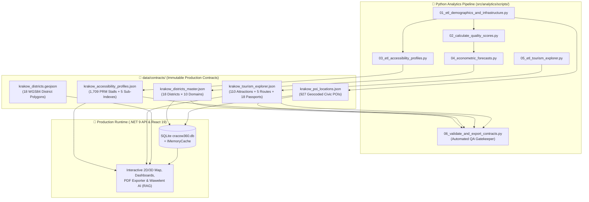

# 📜 Cracow360 — Final Analytical Data Contracts (`data/contracts/`)

> 🌐 **Documentation in two languages / Dokumentacja w dwóch językach:**  
> 🇬🇧 **English (Current)** | 🇵🇱 **[Polski (README-pl.md)](./README-pl.md)**

-2563EB?style=for-the-badge)
-F59E0B?style=for-the-badge&logo=json&logoColor=white)

---

## 📌 Architectural Overview

This directory serves as the **Single Source of Truth (SSoT)** bridging the offline **Python Data Science & Econometric Pipeline** ([`src/analytics/scripts/`](../../src/analytics/scripts/README.md)) and the production runtime stack (**.NET 9 Web API** + **React 19 Frontend**).

All JSON contracts in this folder are deterministically compiled, normalized to `camelCase` keys matching C# / TypeScript DTO conventions, and audited by the automated **Gatekeeper QA script** (`06_validate_and_export_contracts.py`).

---

## 🗂️ Contract Catalog & Schema Specification

### 1. `krakow_districts_master.json`
- **Producer**: `04_econometric_forecasts.py` (consolidating outputs of Steps `01` → `02` → `04`)
- **Primary Consumers**: `DatabaseSeeder.cs` → `Districts` SQLite table, `/api/v1/districts`, `/api/v1/rankings`, `/api/v1/b2b-forecasts`, and Wawelent AI RAG context builder.
- **Structure**: Contains a top-level `metadata` block and a `districts` array of **18 district objects** (`districtId: 1..18`). Each district encapsulates **10 strongly-typed domain sections**:

| JSON Property (`camelCase`) | C# Owned Entity | Key Metrics & Analytical Indicators Included |
| :--- | :--- | :--- |
| **`scores`** | `DistrictScores` | `overallQualityScore` (`0–100`) and 8 normalized pillar scores: `childcareIndex`, `greeneryIndex`, `mobilityIndex`, `infrastructureIndex`, `airQualityIndex`, `safetyIndex`, `housingAffordabilityIndex`, `cultureAndSocietyIndex`. |
| **`demographics`** | `DistrictDemographics` | `totalPopulation` (`permanentResidents + temporaryResidents`, **736,035** city-wide in 2025), `populationDensityPerSqKm`, `childrenAge0To3`, `childrenAge4To6`, `childrenAge7To14`, `seniorsAge65Plus`, `registeredForeignersCount` (`12,066` city-wide), `agingIndexPer100Youth`, `populationGrowthRate3YrPct` (`2023` vs `2025`). |
| **`educationAndCare`** | `DistrictEducationAndCare` | Counts & capacities of public/private nurseries (`nurseriesPublicCount`, `nurseriesPrivateCount`, `nurseryTotalCapacity`, `nurseryTotalVacancies`, `nurseryCoverageRatioPct`, `averagePrivateNurseryFeePln`), kindergartens (`kindergartensTotalCapacity`), primary schools (`primarySchoolsTotalStudents`, `studentsPerClassRatio`), and `parentAndKidsClubsCount`. |
| **`mobilityAndTransport`** | `DistrictMobilityAndTransport` | `publicTransportStopsCount`, `stopsPerSqKm`, `bikeRacksCount`, `parkAndRideCount`, `parkAndRideTotalCapacity`, `cyclingPathsLengthKm`, `cyclingPathsPerSqKm`, `transitAccessibility15MinPct` (spatial Poisson 500 m coverage). |
| **`greeneryAndSport`** | `DistrictGreeneryAndSport` | `parksCount`, `pocketParksCount`, `totalParksAreaHa`, `forestsCount`, `totalForestsAreaHa`, `greenShareOfDistrictAreaPct`, `greenAreaSqMetersPerCapita`, `schoolSportFacilitiesCount`, `swimmingPoolsCount`. |
| **`cultureAndSociety`** | `DistrictCultureAndSociety` | Territorial network of **56 municipal cultural branches/clubs** (`culturalCentersCount >= 1` across all 18 districts, `culturalEventsCount`, `culturalEventParticipants`, `culturalSubsidyPln`), `publicLibrariesCount`, `libraryBookCollection`, `libraryReadersCount`, and `seniorCentersCasCount` (`casMembersCount`, `casAvgAttendance`). |
| **`publicSafety`** | `DistrictPublicSafety` | `trafficAccidentsCount`, `collisionsCount`, `vulnerableRoadUsersInjured`, `accidentsPer10kPop`, `safetySurveyScorePct`, `lightingAndCrosswalksScorePct`. |
| **`housingMarket`** | `DistrictHousingMarket` | `avgPricePerSqmPrimaryPln`, `avgPricePerSqmSecondaryPln`, `medianRentTwoRoomPln`, `priceGrowthYoYPct`, `newApartmentsCompleted`, `affordabilitySqmPerAvgSalary`. |
| **`environmentalQuality`** | `DistrictEnvironmentalQuality` | Multi-grid CAMS atmospheric averages: `avgAnnualPm10`, `avgAnnualPm25`, `avgAnnualNo2`, `avgEuropeanAqi`, `smogDaysOverLimitCount`. |
| **`forecastsAndB2B`** | `DistrictForecastsAndB2B` | 2028 econometric cohort forecasts (`predictedAge0To3In2028`, `predictedAge4To6In2028`, `predictedAge7To14In2028`), `projectedNurserySeatDeficit2028`, `projectedKindergartenSeatBalance2028`, `b2bChildcareInvestmentScore` (`0–100`), fiscal revenues (`citTaxpayersCount`, `citTaxRevenuePln`, `pitTaxRevenuePln`, `propertyTaxRevenuePln`, `fiscalPotentialPerSqKmPln`), and `recommendedAction`. |

---

### 2. `krakow_poi_locations.json`
- **Producer**: `01_etl_demographics_and_infrastructure.py`
- **Primary Consumers**: `DatabaseSeeder.cs` → `PointsOfInterest` SQLite table, `/api/v1/pois`
- **Structure**: Contains **927 geocoded Points of Interest** with deterministic IDs (`nursery_public_1`, `city_park_5`, `library_12`, `cas_3`, etc.), assigned to `districtId` (`1..18`) via `shapely` point-in-polygon spatial join and classified into 4 top-level categories (`EDU_CARE`, `GREENERY`, `MOBILITY`, `CULTURE_SOCIETY`).

---

### 3. `krakow_accessibility_profiles.json`
- **Producer**: `03_etl_accessibility_profiles.py`
- **Primary Consumers**: `/api/v1/accessibility` ("Kraków Bez Barier" module)
- **Structure**:
  - `citySummary`: City-wide totals (**1,709 PRM disabled parking stalls** across **862 locations**, **25 architecturally audited public facilities**, city-wide Kassel kerb % and tactile paving %).
  - `districts`: **18 accessibility profiles** scored across 5 user-group indices (`0–100`): `mobilityScore`, `visualScore`, `hearingScore`, `seniorScore`, `familyStrollerScore`, and weighted `overallAccessibilityScore`.

---

### 4. `krakow_tourism_explorer.json`
- **Producer**: `05_etl_tourism_explorer.py`
- **Primary Consumers**: `/api/v1/tourism` ("Smart Tourism & Overtourism Relief" module)
- **Structure**:
  - `cityTourismSummary`: Aggregate city-wide tourism telemetry (`totalAttractionsCount: 110`, hidden gems count, average crowd level, overtourism relief index).
  - `attractions`: **110 geocoded attractions** across all 18 districts with `crowdLevel` (`1..5`), `isHiddenGem`, `bestTimeToVisit`, `estimatedDurationMin`, `nearestTransitStop`, and `accessibilityFriendly`.
  - `overtourismAlternatives`: **5 curated decongestion pairs** redirecting visitors from saturated hotspots (`crowdLevel >= 4`) to tranquil alternatives (`crowdLevel <= 2`) with computed `crowdReductionPct`.
  - `itineraries`: **5 thematic routes** with exact Haversine distances (`totalDistanceKm`) and walking durations.
  - `districtTourismPassports`: **18 District Tourism Passports** featuring local attraction counts, hospitality profiles, and cultural event density.

---

### 5. `krakow_districts.geojson`
- **Format**: Standard RFC 7946 `GeoJSON` (`FeatureCollection`, CRS `EPSG:4326` / `WGS84`).
- **Structure**: Contains the **18 administrative boundary polygons** (`Polygon` / `MultiPolygon`) of Krakow's districts (`id: 1..18`, `name`, `symbol`). Used by both the Python spatial join engine (`shapely`) and the React 19 interactive choropleth map (`Leaflet` / `Deck.gl`).

---

## 🛡️ Automated Contract Verification (Gatekeeper Step `06`)

> [!IMPORTANT]
> Never edit files in `data/contracts/` manually. Any schema or metric change must be implemented in [`src/analytics/scripts/`](../../src/analytics/scripts/README.md) and verified by running `06_validate_and_export_contracts.py`, which enforces:
> - **Completeness**: Exactly `18` districts (`1..18`) with zero `NaN` / `null` / `Infinity` values.
> - **Geographic Bounding Box**: All `927` POIs and `110` tourist attractions strictly within Krakow (`lat ∈ [49.95, 50.15]`, `lon ∈ [19.75, 20.25]`).
> - **Score Normalization**: All QoL and Accessibility indices strictly within `[0.0, 100.0]`.
> - **Cross-Domain Integrity**: Non-zero positive totals across demographics, air quality, road safety, housing market, and municipal cultural networks (`culturalCentersCount >= 1` in all 18 districts).
