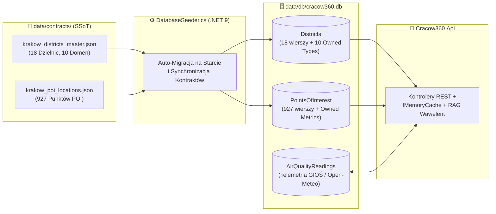

# 🗄️ Cracow360 — Operacyjna Baza Danych SQLite (`data/db/`)

> 🌐 **Dokumentacja w dwóch językach / Documentation in two languages:**  
> 🇬🇧 **[English (README.md)](./README.md)** | 🇵🇱 **Polski (Aktualny)**


---

## 📌 Rola Architektoniczna

Ten katalog przechowuje lokalny plik relacyjnej bazy danych **SQLite 3** (`cracow360.db`), wykorzystywany w czasie rzeczywistym przez warstwę backendową **.NET 9 Web API** (`Cracow360.Api` / `Cracow360.Infrastructure`).

W architekturze **Cracow360** baza SQLite pełni rolę **szybkiego magazynu operacyjnego (Read/Query Store)** zasilanego z niemodyfikowalnych kontraktów analitycznych JSON z katalogu [`data/contracts/`](../contracts/README-pl.md) oraz z bieżącej telemetrii środowiskowej:



> [!NOTE]
> Specjalistyczne kontrakty `krakow_accessibility_profiles.json` oraz `krakow_tourism_explorer.json`, a także granice wektorowe `krakow_districts.geojson`, są serwowane bezpośrednio z katalogu [`data/contracts/`](../contracts/README-pl.md) przez dedykowane serwisy backendowe wspierane przez `IMemoryCache`, bez nadmiarowego duplikowania ich struktury w tabelach SQLite.

---

## 🧱 Schemat Relacyjny (`Cracow360DbContext`)

Schemat bazy danych jest zdefiniowany za pomocą Fluent API w pliku `src/backend/Cracow360.Infrastructure/Persistence/Cracow360DbContext.cs`:

| Nazwa Tabeli | Klucz Główny (PK) | Liczba Wierszy | Encja Domenowa | Opis i Mapowanie Entity Framework Core |
| :--- | :--- | :---: | :--- | :--- |
| **`Districts`** | `DistrictId` (`INTEGER`, `1..18`, `ValueGeneratedNever`) | **18** | `District` | Główna tabela 18 dzielnic administracyjnych Krakowa (`Symbol`, `Name`, `AreaSqKm`, `CentroidLat`, `CentroidLon`). Spłaszcza **10 obiektów domenowych (Owned Entity Types)** bezpośrednio do kolumn tabeli poprzez `OwnsOne`: `Scores` (8 filarów QoL + `OverallQualityScore`), `Demographics`, `EducationAndCare`, `MobilityAndTransport`, `GreeneryAndSport`, `PublicSafety`, `HousingMarket`, `EnvironmentalQuality`, `CultureAndSociety` oraz `ForecastsAndB2B`. |
| **`PointsOfInterest`** | `Id` (`TEXT`, max `100` znaków) | **927** | `PointOfInterest` | Zgeokodowane obiekty infrastruktury miejskiej (żłobki, przedszkola, szkoły podstawowe, parki miejskie i kieszonkowe, lasy, parkingi P+R, biblioteki oraz Centra Aktywności Seniorów CAS). Powiązane kluczem obcym `DistrictId` (`OnDelete: Cascade`). Przechowuje `Category` (`PoiCategory`) i `SubCategory` (`PoiSubCategory`) jako czytelne łańcuchy znaków (`HasConversion<string>()`) oraz zagnieżdżone metryki `Metrics` (`PoiMetrics`: `Capacity`, `Vacancies`, `MonthlyFeePln`, `AreaHa`, `SpotsCount`). |
| **`AirQualityReadings`** | `Id` (`INTEGER`, Identity) | *Dynamiczna* | `AirQualityStationReading` | Historyczne i bieżące odczyty telemetrii jakości powietrza (`StationId`, `StationName`, `MeasuredAtUtc`, `Pm10`, `Pm25`, `No2`, `OverallIndexLevel`) zapisywane przez procesy tła. |

---

## 🔄 Samonaprawiający Cykl Życia i Kompatybilność z Dockerem (`DatabaseSeeder.cs`)

Baza danych **nie wymaga ręcznego wykonywania skryptów SQL**. Cały jej cykl życia jest zautomatyzowany podczas uruchamiania `Cracow360.Api` w metodzie `DatabaseSeeder.SeedAsync()`:

1. **Inicjalizacja Katalogu i Schematu**: Sprawdza istnienie katalogu `data/db/` i wywołuje `dbContext.Database.EnsureCreatedAsync()`.
2. **Automatyczna Detekcja Rozjazdu Schematu (Self-Healing)**: Wykonuje lekkie zapytanie kontrolne do tabeli `dbContext.Districts`. W przypadku wykrycia niezgodności schematu (np. po dodaniu nowych pól analitycznych w klasach C#), `DatabaseSeeder` automatycznie usuwa przestarzały plik bazy (`EnsureDeletedAsync()`) i buduje czysty schemat od nowa (`EnsureCreatedAsync()`).
3. **Klasyczny Tryb Dziennika (`PRAGMA journal_mode=DELETE;`)**: Jawnie wyłącza pliki tymczasowe WAL (`-wal` / `-shm`) na rzecz klasycznego dziennika wycofywania. Dzięki temu narzędzia takie jak **JetBrains Rider Database Tools** czy **DB Browser for SQLite** na systemie gospodarza mogą bezpiecznie przeglądać plik `cracow360.db` w czasie rzeczywistym, nawet gdy aplikacja działa wewnątrz kontenera **Docker**.
4. **Idempotentna Synchronizacja Kontraktów**: Przy każdym starcie backendu `DatabaseSeeder` wczytuje pliki `krakow_districts_master.json` (18 dzielnic) oraz `krakow_poi_locations.json` (927 punktów POI), aktualizuje tabele `Districts` i `PointsOfInterest` w jednej transakcji oraz czyści klucz pamięci podręcznej `IMemoryCache` (`districts_all`).

---

## 🛠️ Podgląd i Resetowanie Bazy Danych

> [!TIP]
> **Chcesz wymusić pełną przebudowę bazy danych od zera?**  
> Ponieważ plik `cracow360.db` jest deterministycznie odtwarzany z katalogu [`data/contracts/`](../contracts/README-pl.md) przy każdym uruchomieniu backendu, możesz w dowolnym momencie bezpiecznie go usunąć:
> ```powershell
> Remove-Item -Force data/db/cracow360.db
> dotnet run --project src/backend/Cracow360.Api
> ```
> W ciągu ~1 sekundy od startu `.NET 9` utworzy nowy plik `cracow360.db` i załaduje wszystkie **18 dzielnic** oraz **927 punktów POI**.
