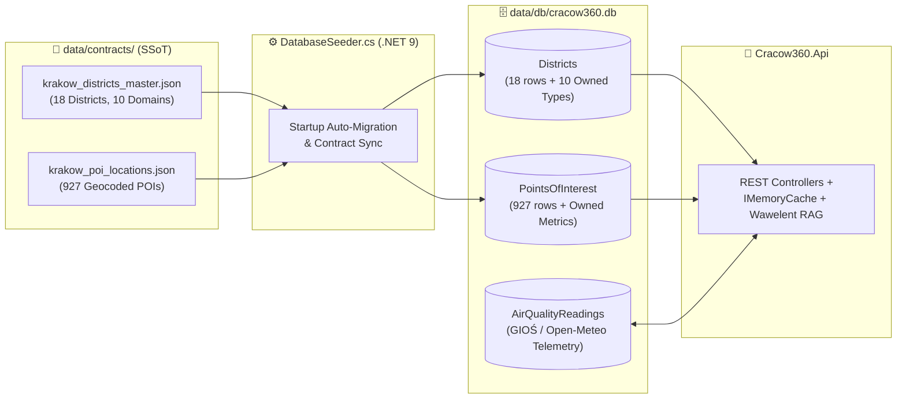

# 🗄️ Cracow360 — SQLite Operational Database (`data/db/`)

> 🌐 **Documentation in two languages / Dokumentacja w dwóch językach:**  
> 🇬🇧 **English (Current)** | 🇵🇱 **[Polski (README-pl.md)](./README-pl.md)**


---

## 📌 Architectural Role

This directory hosts the local **SQLite 3** relational database file (`cracow360.db`) used at runtime by the **.NET 9 Web API** (`Cracow360.Api` / `Cracow360.Infrastructure`).

In the **Cracow360** architecture, SQLite acts as a **high-speed operational read/query store** layered over the immutable JSON analytical contracts in [`data/contracts/`](../contracts/README.md) and live environmental telemetry fetched in the background:



> [!NOTE]
> The specialized contracts `krakow_accessibility_profiles.json` and `krakow_tourism_explorer.json`, as well as the boundary polygons in `krakow_districts.geojson`, are served directly from [`data/contracts/`](../contracts/README.md) via dedicated backend services with in-memory caching rather than being duplicated inside SQLite tables.

---

## 🧱 Relational Schema (`Cracow360DbContext`)

The schema is configured via Fluent API in `src/backend/Cracow360.Infrastructure/Persistence/Cracow360DbContext.cs`:

| Table Name | Primary Key | Row Count | Domain Entity | Description & EF Core Mapping Details |
| :--- | :--- | :---: | :--- | :--- |
| **`Districts`** | `DistrictId` (`INTEGER`, `1..18`, `ValueGeneratedNever`) | **18** | `District` | Master table of Krakow's 18 administrative districts (`Symbol`, `Name`, `AreaSqKm`, `CentroidLat`, `CentroidLon`). Flattens **10 Owned Entity Types** (`OwnsOne`) directly into the table row: `Scores` (8 QoL pillars + `OverallQualityScore`), `Demographics`, `EducationAndCare`, `MobilityAndTransport`, `GreeneryAndSport`, `PublicSafety`, `HousingMarket`, `EnvironmentalQuality`, `CultureAndSociety`, and `ForecastsAndB2B`. |
| **`PointsOfInterest`** | `Id` (`TEXT`, max `100` chars) | **927** | `PointOfInterest` | Geocoded civic facilities (nurseries, kindergartens, primary schools, parks, pocket parks, forests, P+R parking lots, libraries, and Senior Activity Centers CAS). Indexed by foreign key `DistrictId` (`OnDelete: Cascade`). Stores `Category` (`PoiCategory`) and `SubCategory` (`PoiSubCategory`) as readable strings (`HasConversion<string>()`) and flattens `Metrics` (`PoiMetrics`: `Capacity`, `Vacancies`, `MonthlyFeePln`, `AreaHa`, `SpotsCount`) via `OwnsOne`. |
| **`AirQualityReadings`** | `Id` (`INTEGER`, Identity) | *Dynamic* | `AirQualityStationReading` | Historical and live air-quality telemetry snapshots (`StationId`, `StationName`, `MeasuredAtUtc`, `Pm10`, `Pm25`, `No2`, `OverallIndexLevel`) persisted by background workers and queried by environmental endpoints. |

---

## 🔄 Self-Healing Lifecycle & Docker Compatibility (`DatabaseSeeder.cs`)

The database requires **zero manual SQL setup**. Its entire lifecycle is automated during `Cracow360.Api` startup via `DatabaseSeeder.SeedAsync()`:

1. **Directory & Schema Provisioning**: Ensures `data/db/` exists and invokes `dbContext.Database.EnsureCreatedAsync()`.
2. **Automatic Schema-Drift Recovery**: Executes a lightweight probe query against `dbContext.Districts`. If an `Exception` occurs (for example, after adding new analytical columns in C# domain entities), `DatabaseSeeder` automatically logs a warning, drops the outdated file (`EnsureDeletedAsync()`), and recreates a clean schema (`EnsureCreatedAsync()`).
3. **Classic Rollback Journal (`PRAGMA journal_mode=DELETE;`)**: Explicitly disables SQLite WAL (`-wal` / `-shm`) files in favor of classic rollback journaling. This guarantees that tools like **JetBrains Rider Database Tools** or **DB Browser for SQLite** on the host OS can inspect `cracow360.db` live even when mounted inside a running **Docker** container.
4. **Idempotent Contract Synchronization**: On every application start, `DatabaseSeeder` reads `krakow_districts_master.json` (18 districts) and `krakow_poi_locations.json` (927 POIs), refreshes the `Districts` and `PointsOfInterest` tables in a single transaction, and invalidates the `IMemoryCache` key (`districts_all`) so the API immediately serves the newest ETL contract state.

---

## 🛠️ Inspecting & Resetting the Database

> [!TIP]
> **Need a clean database rebuild?**  
> Because `cracow360.db` is deterministically hydrated from [`data/contracts/`](../contracts/README.md) on every backend startup, you can safely reset it at any time:
> ```powershell
> Remove-Item -Force data/db/cracow360.db
> dotnet run --project src/backend/Cracow360.Api
> ```
> Within ~1 second of launch, `.NET 9` will recreate `cracow360.db` and re-seed all **18 districts** and **927 POIs**.
