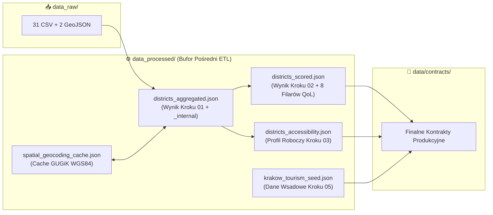

# ⚙️ Cracow360 — Bufor Pośredni ETL i Pamięć Podręczna Geokodowania (`src/analytics/data_processed/`)

> 🌐 **Dokumentacja w dwóch językach / Documentation in two languages:**  
> 🇬🇧 **[English (README.md)](./README.md)** | 🇵🇱 **Polski (Aktualny)**

-F59E0B?style=for-the-badge&logo=json&logoColor=white)

---

## 📌 Rola Architektoniczna

Ten katalog pełni rolę **bufora pośredniego (Staging Area) oraz trwałej pamięci podręcznej geokodowania** dla potoku analitycznego Python ([`src/analytics/scripts/`](../scripts/README-pl.md)).

Odseparowanie warstwy `data_processed/` zarówno od [`data_raw/`](../data_raw/README-pl.md) (niemodyfikowalnych tabel źródłowych), jak i od [`data/contracts/`](../../../data/contracts/README-pl.md) (produkcyjnych kontraktów API) zapewnia trzy kluczowe korzyści inżynieryjne:
1. **Modularność Potoku**: Kolejne skrypty (`01` → `02` → `04` oraz `01` → `03`) przekazują między sobą pomocnicze zmienne robocze w sekcji `_internal` (np. jednoroczne kohorty urodzeń czy liczniki peronów z krawężnikami Kassel), które są automatycznie oczyszczane przed publikacją finalnego kontraktu.
2. **Natychmiastowe Geokodowanie (Zero-Latency Cache)**: Plik `spatial_geocoding_cache.json` utrwala odpowiedzi z rządowego serwisu **GUGiK UUG API**, skracając czas wykonania kolejnych przebiegów potoku z ~12 minut zapytań sieciowych do **poniżej 10 sekund**.
3. **Baza Referencyjna Smart Tourism**: Przechowuje plik wsadowy `krakow_tourism_seed.json`, wzbogacany przestrzennie i matematycznie przez skrypt `05_etl_tourism_explorer.py`.

---

## 🗂️ Szczegółowa Specyfikacja Plików (5 Artefaktów JSON)

| Nazwa Pliku | Generator | Odbiorca / Kolejny Krok | Rola Techniczna i Zawartość |
| :--- | :--- | :--- | :--- |
| **`districts_aggregated.json`** | `01_etl_demographics_and_infrastructure.py` | `02_calculate_quality_scores.py`, `03_etl_accessibility_profiles.py` | Zawiera pełne agregacje terytorialne i demograficzne dla 18 dzielnic (`demographics`, `educationAndCare`, `mobilityAndTransport`, `greeneryAndSport`, `cultureAndSociety`, `publicSafety`, `housingMarket`, `environmentalQuality`, `fiscalB2B`) oraz roboczy słownik **`_internal`** (`birthCohorts` 2018–2025, `pop2023`, `pop2024`, `pop2025`, `primarySchoolClasses`, `kasselKerbStops`, `tactilePavingStops`) usuwany przy eksporcie kontraktu. |
| **`districts_scored.json`** | `02_calculate_quality_scores.py` | `04_econometric_forecasts.py` | Wzbogaca `districts_aggregated.json` o obiekt **`scores`** zawierający 8 znormalizowanych sub-indeksów jakości życia (`0–100`) oraz ważony wskaźnik główny `overallQualityScore`. |
| **`districts_accessibility.json`** | `03_etl_accessibility_profiles.py` | `06_validate_and_export_contracts.py` | Robocza kopia profilu dostępności architektonicznej i parkingowej PRM (`citySummary` + 18 profili dzielnic w 5 sub-indeksach), synchronizowana z kontraktem `data/contracts/krakow_accessibility_profiles.json`. |
| **`spatial_geocoding_cache.json`** | `01_etl_demographics_and_infrastructure.py` | `01_etl_demographics_and_infrastructure.py`, `03_etl_accessibility_profiles.py` | Trwały słownik klucz–wartość mapujący znormalizowane adresy krakowskie (`"ul. Dobrego Pasterza 100, Kraków"`) na zweryfikowane współrzędne `{ "lat": 50.088..., "lon": 19.981..., "source": "GUGIK_UUG" }`. **Plik należy zachowywać w repozytorium**, aby unikać ponownego odpytywania serwerów GUGiK. |
| **`krakow_tourism_seed.json`** | Wsadowy Zbiór Domenowy | `05_etl_tourism_explorer.py` | Strukturalny wsad zawierający 110 wyselekcjonowanych atrakcji turystycznych, 5 par alternatyw odciążających (overtourism relief) oraz 5 tras tematycznych, które Krok `05` wzbogaca o złączenia przestrzenne GIS, dystanse Haversine oraz Paszporty Turystyczne Dzielnic. |

---

## 🛠️ Wskazówki Eksploatacyjne

> [!TIP]
> - Pliki **`districts_aggregated.json`**, **`districts_scored.json`** oraz **`districts_accessibility.json`** są automatycznie nadpisywane podczas każdego uruchomienia potoku (`01` → `06`).
> - Pliki **`spatial_geocoding_cache.json`** oraz **`krakow_tourism_seed.json`** stanowią trwałe zasoby operacyjne projektu i **nie powinny być usuwane**.
