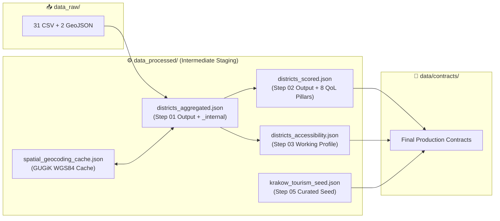

# ⚙️ Cracow360 — Intermediate ETL Buffer & Operational Cache (`src/analytics/data_processed/`)

> 🌐 **Documentation in two languages / Dokumentacja w dwóch językach:**  
> 🇬🇧 **English (Current)** | 🇵🇱 **[Polski (README-pl.md)](./README-pl.md)**

-F59E0B?style=for-the-badge&logo=json&logoColor=white)

---

## 📌 Architectural Purpose

This directory acts as the **intermediate staging buffer and operational cache** for the Python analytical pipeline ([`src/analytics/scripts/`](../scripts/README.md)).

Separating `data_processed/` from both [`data_raw/`](../data_raw/README.md) (immutable source tables) and [`data/contracts/`](../../../data/contracts/README.md) (production API contracts) provides three critical engineering benefits:
1. **Pipeline Modularity**: Each script (`01` → `02` → `04` and `01` → `03`) can pass internal working state (such as raw single-year birth cohorts or transit stop barrier counts inside `_internal`) without polluting the public C# / TypeScript contracts.
2. **Zero-Latency Geocoding Persistence**: `spatial_geocoding_cache.json` caches every resolved address from the **GUGiK UUG API**, reducing subsequent pipeline runs from ~12 minutes of HTTP calls to **< 10 seconds**.
3. **Curated Domain Seeding**: Stores `krakow_tourism_seed.json`, the structured input consumed by Step `05` (`05_etl_tourism_explorer.py`).

---

## 🗂️ Detailed File Specification (5 JSON Artifacts)

| File Name | Producer | Consumer(s) | Technical Role & Internal Payload |
| :--- | :--- | :--- | :--- |
| **`districts_aggregated.json`** | `01_etl_demographics_and_infrastructure.py` | `02_calculate_quality_scores.py`, `03_etl_accessibility_profiles.py` | Contains the raw territorial and demographic aggregations for all 18 districts (`demographics`, `educationAndCare`, `mobilityAndTransport`, `greeneryAndSport`, `cultureAndSociety`, `publicSafety`, `housingMarket`, `environmentalQuality`, `fiscalB2B`) plus the private **`_internal`** dictionary (`birthCohorts` 2018–2025, `pop2023`, `pop2024`, `pop2025`, `primarySchoolClasses`, `kasselKerbStops`, `tactilePavingStops`) stripped prior to final export. |
| **`districts_scored.json`** | `02_calculate_quality_scores.py` | `04_econometric_forecasts.py` | Enriches `districts_aggregated.json` with the **`scores`** object containing the 8 normalized Quality-of-Life (QoL) indices (`0–100`) and the weighted `overallQualityScore`. |
| **`districts_accessibility.json`** | `03_etl_accessibility_profiles.py` | `06_validate_and_export_contracts.py` | Local staging copy of the architectural & PRM accessibility profile (`citySummary` + 18 district profiles across 5 user-group sub-indices), mirrored to `data/contracts/krakow_accessibility_profiles.json`. |
| **`spatial_geocoding_cache.json`** | `01_etl_demographics_and_infrastructure.py` | `01_etl_demographics_and_infrastructure.py`, `03_etl_accessibility_profiles.py` | Persistent key-value dictionary mapping normalized Krakow street addresses (`"ul. Dobrego Pasterza 100, Kraków"`) to verified `{ "lat": 50.088..., "lon": 19.981..., "source": "GUGIK_UUG" }` coordinates. **Commit and preserve this file** to avoid re-querying external GUGiK servers. |
| **`krakow_tourism_seed.json`** | Curated Domain Seed | `05_etl_tourism_explorer.py` | Structured input containing 110 curated tourist attractions, 5 overtourism alternative pairs, and 5 thematic routes, which Step `05` enriches with spatial district joins, Haversine route lengths, and District Tourism Passports. |

---

## 🛠️ Maintenance Notes

> [!TIP]
> - **`districts_aggregated.json`**, **`districts_scored.json`**, and **`districts_accessibility.json`** are automatically overwritten every time you run the pipeline (`01` → `06`).
> - **`spatial_geocoding_cache.json`** and **`krakow_tourism_seed.json`** are version-controlled operational assets and **should not be deleted** when cleaning temporary build outputs.
