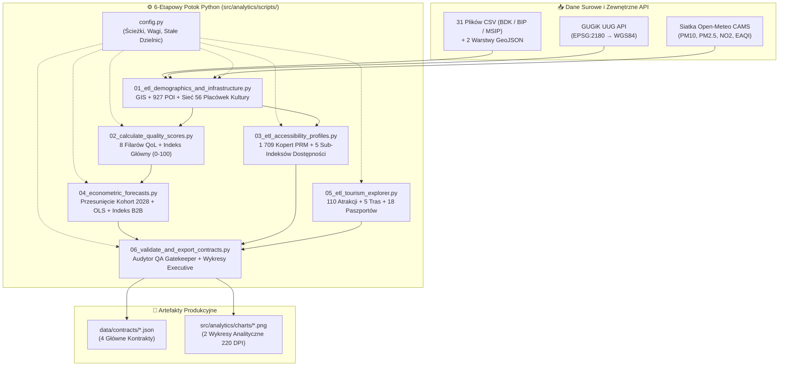

# 🧪 Cracow360 — Potok Data Science, Analiz Przestrzennych GIS i Ekonometrii (`src/analytics/scripts/`)

> 🌐 **Dokumentacja w dwóch językach / Documentation in two languages:**  
> 🇬🇧 **[English (README.md)](./README.md)** | 🇵🇱 **Polski (Aktualny)**


---

## 📌 Rola Architektoniczna

Ten katalog zawiera kompletny, **6-etapowy offline'owy potok ETL, analiz przestrzennych GIS, wielokryterialnego scoringu oraz modelowania ekonometrycznego** platformy **Cracow360**.

Zgodnie z kluczowym założeniem architektonicznym projektu — **pełną separacją ciężkich obliczeń numerycznych i geoprzestrzennych od warstwy serwującej w czasie rzeczywistym** — wszystkie transformacje układów współrzędnych (`EPSG:2178` / `EPSG:3857` / `EPSG:2180` → `WGS84`), złączenia punkt-w-poligonie, model izochron dostępności Poissona, normalizacja 8 filarów jakości życia oraz prognozy kohortowe na rok 2028 wykonywane są tutaj, generując gotowe kontrakty do [`data/contracts/`](../../../data/contracts/README-pl.md).



---

## 🔬 Szczegółowa Specyfikacja Poszczególnych Skryptów

### ⚙️ `config.py` — Centralna Konfiguracja i Stałe Domenowe
Definiuje ścieżki systemowe (`RAW_DATA_DIR`, `PROCESSED_DATA_DIR`, `CONTRACTS_DIR`, `CHARTS_DIR`), słownik referencyjny **18 Dzielnic Administracyjnych Krakowa** (`DISTRICTS_META`), kaskadę kodowań plików CSV (`utf-8-sig`, `utf-8`, `cp1250`, `latin1`) oraz **wagi 8 filarów jakości życia** (`QOL_WEIGHTS`).

---

### 1️⃣ `01_etl_demographics_and_infrastructure.py` — Silnik Przestrzenny GIS i Agregacja Domenowa
- **Transformacja Układów Współrzędnych (`pyproj`)**:
  - Konwertuje stojaki rowerowe ZTP z układu `EPSG:2178` (PUWG 2000 strefa 7) → `WGS84`.
  - Konwertuje przystanki KMK z układu `EPSG:3857` (Web Mercator) → `WGS84`.
  - Geokoduje adresy placówek przez **GUGiK UUG API** (`EPSG:2180` → `WGS84`) z użyciem trwałego cache'u `spatial_geocoding_cache.json` oraz 152 ręcznych korekt GIS (`Korekty_Geoprzestrzenne_POI.csv`).
- **Symetryczny Bilans Demograficzny (`2023–2025`)**:
  - Agreguje jednoroczne roczniki wieku (`0–3`, `4–6`, `7–14`, `65+`) dla meldunków stałych (`703 718`) oraz czasowych (`32 317`), wyznaczając spójną bazę **736 035 zameldowanych mieszkańców** w 2025 r.
  - Wyodrębnia `registeredForeignersCount` (`12 066`) jako osobny wskaźnik, dzięki czemu 3-letnia dynamika ludności (`populationGrowthRate3YrPct`, `2023` vs `2025`) porównuje identyczne zakresy metodologiczne.
- **Przestrzenny Model Izochrony Poissona (Dostępność 15-Minutowa KMK)**:
  $$\text{TransitCoverage}_{500\text{m}} = \min\!\left(99.5,\; \left(1 - e^{-\lambda_{\text{eff}} \cdot \pi r^2}\right) \times 100\right), \quad r = 0.5\text{ km},\; \lambda_{\text{eff}} = 0.35 \cdot \frac{N_{\text{stops}}}{A_{\text{district}}}$$
- **Terytorialna Alokacja Sieci Ośrodków Kultury (`CULTURAL_NETWORK_SHARES`)**:
  - Eliminuje zniekształcenie sprawozdawcze (w którym wielooddziałowe instytucje kultury raportowały całą działalność pod adresem centrali, a *Krakowskie Forum Kultury* posiadało dwa wiersze półroczne), przypisując wszystkie **56 filii i klubów lokalnych** (`Centrum Kultury Podgórza`, `Krakowskie Forum Kultury`, `Ośrodek Kultury Kraków-Nowa Huta`, `CK Dworek Białoprądnicki`, `NCK` i in.) do właściwych dzielnic (`1..18`). Każda z 18 dzielnic posiada `culturalCentersCount >= 1`, a wydarzenia, uczestnicy i dotacje rozliczane są proporcjonalnie do potencjału sieci.
- **Pliki wyjściowe**: `data_processed/districts_aggregated.json` oraz `data/contracts/krakow_poi_locations.json` (**927 punktów POI**).

---

### 2️⃣ `02_calculate_quality_scores.py` — Wielokryterialny Silnik 8 Filarów Jakości Życia (QoL)
Oblicza 8 znormalizowanych sub-indeksów (`[0.0, 100.0]`) oraz ważony wskaźnik główny `overallQualityScore`:

| Klucz Filaru QoL | Waga | Formuła i Składowe Wskaźnika |
| :--- | :---: | :--- |
| **`childcareIndex`** | **20%** | $0.45 \cdot \text{NurseryCov} + 0.35 \cdot \text{KindergartenCov} + 0.20 \cdot \text{PrimarySchoolComfort}$ (gdzie pokrycie przedszkolne uwzględnia rocznik 3-latków: $\text{Wiek}_{4\text{–}6} + 0.25 \cdot \text{Wiek}_{0\text{–}3}$ względem benchmarku $1.50\times$). |
| **`greeneryIndex`** | **15%** | $0.55 \cdot \text{UdziałZieleni} + 0.45 \cdot \ln(1 + \text{ZieleńM2NaMieszkańca})$ |
| **`mobilityIndex`** | **15%** | $0.45 \cdot \text{GęstośćPrzystanków} + 0.35 \cdot \text{GęstośćRowerowa} + 0.20 \cdot \text{Izochrona15Min}$ |
| **`airQualityIndex`** | **12%** | $0.45 \cdot \text{Score}_{\text{PM2.5}} + 0.30 \cdot \text{Score}_{\text{EAQI}} + 0.25 \cdot \text{Score}_{\text{DniSmogowe}}$ |
| **`safetyIndex`** | **10%** | $0.40 \cdot \text{AnkietaBezpieczeństwa} + 0.35 \cdot \text{NiskaWypadkowość} + 0.25 \cdot \text{OświetleniePrzejścia}$ |
| **`infrastructureIndex`** | **10%** | $0.50 \cdot \text{ObiektySportoweNa10k} + 0.30 \cdot \text{Pływalnie} + 0.20 \cdot \text{ParkAndRide}$ |
| **`housingAffordabilityIndex`** | **10%** | $0.45 \cdot \text{DostępnośćPłacowaM2} + 0.30 \cdot \text{DostępnośćNajmu} + 0.25 \cdot \text{NowaPodaż}$ |
| **`cultureAndSocietyIndex`** | **8%** | $0.35 \cdot \text{WydarzeniaNa1k} + 0.35 \cdot \text{KsięgozbiórNaMieszkańca} + 0.30 \cdot \text{CASNa1kSeniorów}$ |

- **Plik wyjściowy**: `data_processed/districts_scored.json`.

---

### 3️⃣ `03_etl_accessibility_profiles.py` — Silnik „Kraków Bez Barier"
Geokoduje **862 lokalizacje kopert parkingowych PRM** (**1 709 stanowisk**) oraz **25 zaudytowanych budynków użyteczności publicznej**, łącząc je z telemetrią przystanków KMK (`kasselKerbPct`, `tactilePavingPct`) w 5 wyspecjalizowanych sub-indeksów:
- `mobilityScore` (25%), `seniorScore` (25%), `familyStrollerScore` (20%), `visualScore` (15%), `hearingScore` (15%).
- **Plik wyjściowy**: `data/contracts/krakow_accessibility_profiles.json`.

---

### 4️⃣ `04_econometric_forecasts.py` — Prognozy Kohortowe 2028 i Indeks Inwestycyjny B2B
- **Deterministyczne Przesunięcie Kohort + Regresja OLS z Tłumieniem Trendu (`horyzont = 3 lata → 2028`)**:
  - Wykorzystuje historyczne kohorty urodzeń (`2018–2025`) z tłumieniem trendu ($\phi = 0.65$) oraz 3-letnim dryfem migracyjnym (`2023–2025`) ograniczonym do przedziału $[-10\%, +18\%]$, wyznaczając `predictedAge0To3In2028`, `predictedAge4To6In2028` oraz `predictedAge7To14In2028`.
- **Deficyt Miejsc i Indeks Inwestycyjny B2B (`0–100`)**:
  - Wylicza `projectedNurserySeatDeficit2028` (względem docelowego progu 65% pokrycia), `projectedKindergartenSeatBalance2028` oraz `b2bChildcareInvestmentScore`, generując spójną rekomendację decyzyjną (`recommendedAction`) obejmującą wszystkie trzy grupy wiekowe (`0–3`, `4–6`, `7–14`).
- **Plik wyjściowy**: `data/contracts/krakow_districts_master.json`.

---

### 5️⃣ `05_etl_tourism_explorer.py` — Silnik Smart Tourism i Dekoncentracji Ruchu Turystycznego
Przetwarza zbiór `krakow_tourism_seed.json`, weryfikuje przynależność przestrzenną **110 atrakcji**, oblicza **dystanse Haversine** dla **5 tras tematycznych**, wyznacza **5 par alternatyw odciążających (overtourism relief)** oraz buduje **18 Paszportów Turystycznych Dzielnic**.
- **Plik wyjściowy**: `data/contracts/krakow_tourism_explorer.json`.

---

### 6️⃣ `06_validate_and_export_contracts.py` — Automatyczny Audytor QA Gatekeeper i Wykresy Executive
Przeprowadza rygorystyczną walidację schematów, typów liczbowych, granic geograficznych oraz sum domenowych we wszystkich 4 kontraktach JSON i generuje 2 wykresy analityczne wysokiej rozdzielczości (`220 DPI`) w `src/analytics/charts/`:
1. `01_nursery_deficit_vs_growth_2028.png`
2. `02_quality_of_life_ranking_18_districts.png`

---

## 🚀 Uruchamianie Pełnego Potoku Analitycznego

```powershell
# Uruchomienie kompletnego potoku w lokalnym środowisku wirtualnym z katalogu src/analytics/
cd src/analytics
.\.venv\Scripts\python.exe scripts/01_etl_demographics_and_infrastructure.py
.\.venv\Scripts\python.exe scripts/02_calculate_quality_scores.py
.\.venv\Scripts\python.exe scripts/03_etl_accessibility_profiles.py
.\.venv\Scripts\python.exe scripts/04_econometric_forecasts.py
.\.venv\Scripts\python.exe scripts/05_etl_tourism_explorer.py
.\.venv\Scripts\python.exe scripts/06_validate_and_export_contracts.py
```
