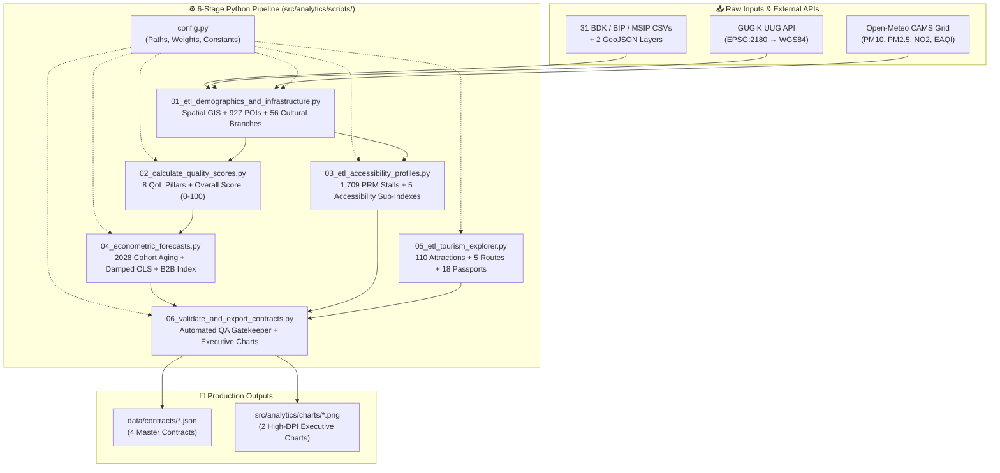

# 🧪 Cracow360 — Offline Data Science, Spatial GIS & Econometric Pipeline (`src/analytics/scripts/`)

> 🌐 **Documentation in two languages / Dokumentacja w dwóch językach:**  
> 🇬🇧 **English (Current)** | 🇵🇱 **[Polski (README-pl.md)](./README-pl.md)**


---

## 📌 Architectural Overview

This directory contains the complete **6-stage offline Python ETL, Spatial GIS, Scoring, and Econometric Pipeline** of **Cracow360**.

Following our core architectural principle — **strict decoupling of heavy numerical & spatial computation from the real-time web runtime** — all coordinate projections (`EPSG:2178` / `EPSG:3857` / `EPSG:2180` → `WGS84`), point-in-polygon joins, Poisson 15-minute city accessibility modeling, 8-pillar Quality-of-Life normalization, and 2028 demographic cohort regressions are executed offline here, compiling immutable contracts into [`data/contracts/`](../../../data/contracts/README.md).



---

## 🔬 Stage-by-Stage Technical Specification

### ⚙️ `config.py` — Central Configuration & Domain Constants
Centralizes filesystem paths (`RAW_DATA_DIR`, `PROCESSED_DATA_DIR`, `CONTRACTS_DIR`, `CHARTS_DIR`), the official dictionary of **18 Krakow Administrative Districts** (`DISTRICTS_META`), multi-encoding CSV fallback order (`utf-8-sig`, `utf-8`, `cp1250`, `latin1`), and the **8 Quality-of-Life pillar weights** (`QOL_WEIGHTS`).

---

### 1️⃣ `01_etl_demographics_and_infrastructure.py` — Spatial GIS & Multi-Domain Aggregation
- **Coordinate Reprojection (`pyproj`)**:
  - Converts ZTP bike racks from `EPSG:2178` (PUWG 2000 zone 7) → `WGS84`.
  - Converts KMK bus/tram stops from `EPSG:3857` (Web Mercator) → `WGS84`.
  - Geocodes street addresses via **GUGiK UUG API** (`EPSG:2180` → `WGS84`) with persistent caching in `spatial_geocoding_cache.json` and 152 manual overrides (`Korekty_Geoprzestrzenne_POI.csv`).
- **Symmetric Demographic Accounting (`2023–2025`)**:
  - Aggregates single-year age cohorts (`0–3`, `4–6`, `7–14`, `65+`) across both permanent (`703,718`) and temporary (`32,317`) registrations for a unified baseline of **736,035 registered residents** in 2025.
  - Tracks `registeredForeignersCount` (`12,066`) as a dedicated indicator so 3-year population growth (`populationGrowthRate3YrPct`, `2023` vs `2025`) compares identical demographic scopes.
- **Spatial Poisson Isochrone Model (15-Minute Transit Coverage)**:
  $$\text{TransitCoverage}_{500\text{m}} = \min\!\left(99.5,\; \left(1 - e^{-\lambda_{\text{eff}} \cdot \pi r^2}\right) \times 100\right), \quad r = 0.5\text{ km},\; \lambda_{\text{eff}} = 0.35 \cdot \frac{N_{\text{stops}}}{A_{\text{district}}}$$
- **Territorial Cultural Network Distribution (`CULTURAL_NETWORK_SHARES`)**:
  - Resolves institutional reporting bias (where multi-branch cultural institutions reported under their headquarters' postal address and *Krakowskie Forum Kultury* reported two half-year rows) by mapping all **56 municipal cultural branches and local clubs** (`Centrum Kultury Podgórza`, `Krakowskie Forum Kultury`, `Ośrodek Kultury Kraków-Nowa Huta`, `CK Dworek Białoprądnicki`, `NCK`, etc.) to their actual physical districts (`1..18`), guaranteeing `culturalCentersCount >= 1` in all 18 districts and proportionally allocating events, participants, and subsidies.
- **Outputs**: `data_processed/districts_aggregated.json` and `data/contracts/krakow_poi_locations.json` (**927 POIs**).

---

### 2️⃣ `02_calculate_quality_scores.py` — 8-Pillar Multi-Criteria Quality-of-Life (QoL) Engine
Computes 8 normalized domain sub-indices (`[0.0, 100.0]`) and the weighted `overallQualityScore`:

| QoL Pillar Key | Weight | Formula & Component Breakdown |
| :--- | :---: | :--- |
| **`childcareIndex`** | **20%** | $0.45 \cdot \text{NurseryCov} + 0.35 \cdot \text{KindergartenCov} + 0.20 \cdot \text{PrimarySchoolComfort}$ (where Kindergarten Coverage accounts for 3-year-olds entering preschool: $\text{Age}_{4\text{–}6} + 0.25 \cdot \text{Age}_{0\text{–}3}$ against a $1.50\times$ benchmark). |
| **`greeneryIndex`** | **15%** | $0.55 \cdot \text{GreenAreaShare} + 0.45 \cdot \ln(1 + \text{GreenSqmPerCapita})$ |
| **`mobilityIndex`** | **15%** | $0.45 \cdot \text{StopDensity} + 0.35 \cdot \text{CyclingDensity} + 0.20 \cdot \text{Transit15MinPct}$ |
| **`airQualityIndex`** | **12%** | $0.45 \cdot \text{Score}_{\text{PM2.5}} + 0.30 \cdot \text{Score}_{\text{EAQI}} + 0.25 \cdot \text{Score}_{\text{SmogDays}}$ |
| **`safetyIndex`** | **10%** | $0.40 \cdot \text{SurveyScore} + 0.35 \cdot \text{LowAccidentScore} + 0.25 \cdot \text{LightingCrosswalks}$ |
| **`infrastructureIndex`** | **10%** | $0.50 \cdot \text{SportPer10kPop} + 0.30 \cdot \text{SwimPools} + 0.20 \cdot \text{ParkAndRide}$ |
| **`housingAffordabilityIndex`** | **10%** | $0.45 \cdot \text{SalaryAffordability} + 0.30 \cdot \text{RentAffordability} + 0.25 \cdot \text{NewSupply}$ |
| **`cultureAndSocietyIndex`** | **8%** | $0.35 \cdot \text{EventsPer1k} + 0.35 \cdot \text{BooksPerCapita} + 0.30 \cdot \text{CasPer1kSeniors}$ |

- **Output**: `data_processed/districts_scored.json`.

---

### 3️⃣ `03_etl_accessibility_profiles.py` — "Kraków Bez Barier" Accessibility Engine
Geocodes **862 PRM disabled parking locations** (**1,709 stalls**) and **25 audited municipal buildings**, combining them with low-floor KMK stop telemetry (`kasselKerbPct`, `tactilePavingPct`) into 5 specialized accessibility scores:
- `mobilityScore` (25%), `seniorScore` (25%), `familyStrollerScore` (20%), `visualScore` (15%), `hearingScore` (15%).
- **Output**: `data/contracts/krakow_accessibility_profiles.json`.

---

### 4️⃣ `04_econometric_forecasts.py` — 2028 Demographic Cohort Shift & B2B Investment Engine
- **Deterministic Cohort Aging + Damped-Trend OLS (`horizon = 3 years → 2028`)**:
  - Uses historical birth cohorts (`2018–2025`) with damped linear trend ($\phi = 0.65$) and 3-year migration drift (`2023–2025`) bounded to $[-10\%, +18\%]$ to project `predictedAge0To3In2028`, `predictedAge4To6In2028`, and `predictedAge7To14In2028`.
- **Childcare Deficit & B2B Investment Score (`0–100`)**:
  - Calculates `projectedNurserySeatDeficit2028` (against a 65% EU Barcelona-target coverage threshold), `projectedKindergartenSeatBalance2028`, and `b2bChildcareInvestmentScore`, generating an actionable Polish policy recommendation (`recommendedAction`) covering all three youth cohorts (`0–3`, `4–6`, `7–14`).
- **Output**: `data/contracts/krakow_districts_master.json`.

---

### 5️⃣ `05_etl_tourism_explorer.py` — Smart Tourism & Overtourism Decongestion Engine
Processes `krakow_tourism_seed.json`, validates spatial polygon membership for **110 attractions**, computes **Haversine route distances** for **5 thematic itineraries**, evaluates **5 overtourism relief pairs**, and compiles **18 District Tourism Passports**.
- **Output**: `data/contracts/krakow_tourism_explorer.json`.

---

### 6️⃣ `06_validate_and_export_contracts.py` — Automated QA Gatekeeper & Executive Charts
Runs strict schema, numeric, bounding-box, and domain assertions across all 4 JSON contracts and renders 2 high-resolution (`220 DPI`) executive charts into `src/analytics/charts/`:
1. `01_nursery_deficit_vs_growth_2028.png`
2. `02_quality_of_life_ranking_18_districts.png`

---

## 🚀 Running the Complete Pipeline

```powershell
# Activate the local Python virtual environment from src/analytics/
cd src/analytics
.\.venv\Scripts\python.exe scripts/01_etl_demographics_and_infrastructure.py
.\.venv\Scripts\python.exe scripts/02_calculate_quality_scores.py
.\.venv\Scripts\python.exe scripts/03_etl_accessibility_profiles.py
.\.venv\Scripts\python.exe scripts/04_econometric_forecasts.py
.\.venv\Scripts\python.exe scripts/05_etl_tourism_explorer.py
.\.venv\Scripts\python.exe scripts/06_validate_and_export_contracts.py
```
